# Customer Segmentation Through Behavioral Clustering

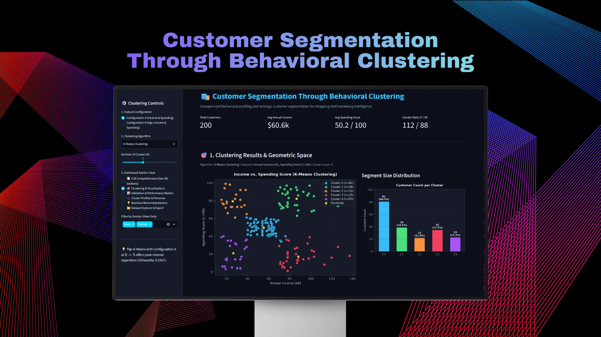


## Project Overview

Customer Segmentation Through Behavioral Clustering is an end-to-end unsupervised machine learning study and interactive analytics dashboard built on the Mall Customers dataset ($N = 200$). The project systematically evaluates K-Means, Agglomerative Hierarchical (Ward linkage), and DBSCAN clustering across competing feature configurations to partition shopping mall patrons into distinct, commercially actionable behavioral segments, accompanied by a dark-mode Streamlit application for interactive exploration and segment export.

## Problem Statement & Objectives

Physical retail shopping malls compete against personalized e-commerce platforms, making generic mall-wide promotional campaigns inefficient and margin-eroding. Because the available customer records contain demographic and spending indicators without predefined target labels, an objective, data-driven unsupervised clustering framework is required to uncover natural customer groupings and translate statistical partitions into targeted retail strategies.

- Conduct a comprehensive data quality audit and exploratory statistical analysis on `Mall_Customers.csv` ($N = 200$).
- Formulate and benchmark two standardized feature spaces: Configuration A (`Annual Income (k$)` and `Spending Score (1-100)`) and Configuration B (`Age`, `Annual Income (k$)`, and `Spending Score (1-100)`).
- Evaluate K-Means and Agglomerative Hierarchical clustering across $k \in [2, 10]$, alongside density-based DBSCAN exploration ($\varepsilon \in [0.25, 0.50]$, $\text{min\_samples} \in [3, 8]$).
- Select an optimal, interpretable clustering solution using Silhouette Score, Davies-Bouldin Index, Calinski-Harabasz Index, and Elbow inertia analysis.
- Profile final segments in original unscaled units and deliver an interactive dark-mode Streamlit dashboard for stakeholder inspection and CSV export.

## Data & Input Sources

The project operates on the local tabular dataset stored at [Mall_Customers.csv](dataset/original/Mall_Customers.csv), comprising 200 customer records across 5 attributes with zero missing values and zero duplicate rows. All 200 records—including two high-income observations at \$137k identified by Tukey's $1.5 \times \text{IQR}$ check—were retained as valid affluent patrons.

| Attribute | Description |
| :--- | :--- |
| Dataset / Input Source | Mall Customers Behavioral & Demographic Dataset |
| Source | [dataset/original/Mall_Customers.csv](dataset/original/Mall_Customers.csv) |
| Format | CSV (`utf-8`) |
| Samples / Records | 200 customer rows (112 Female / 56.0%, 88 Male / 44.0%) |
| Features / Input Shape | 5 columns (`CustomerID`, `Gender`, `Age`, `Annual Income (k$)`, `Spending Score (1-100)`) |
| Target / Label | Unlabeled (unsupervised behavioral clustering) |

## Data Preprocessing & Feature Engineering

Because distance-based clustering algorithms rely on Euclidean geometry, raw features with wider numeric scales (`Annual Income` 15–137, `Spending Score` 1–99, `Age` 18–70) would otherwise dominate distance computations, while identifiers and binary categoricals would introduce artificial distortion. The preprocessing pipeline isolates continuous behavioral features and applies independent Z-score standardization prior to modeling.

| Transformation | Input Features | Output / Role |
| :--- | :--- | :--- |
| Identifier Removal | `CustomerID` (1–200) | Excluded from distance matrix; retained as row lookup key |
| Categorical Isolation | `Gender` (`Male` / `Female`) | Excluded from Euclidean distance; retained for post-hoc profiling |
| Feature Set A (`X_A`) | `Annual Income (k$)`, `Spending Score (1-100)` | 2D core behavioral feature matrix ($200 \times 2$) |
| Feature Set B (`X_B`) | `Age`, `Annual Income (k$)`, `Spending Score (1-100)` | 3D demographic-behavioral feature matrix ($200 \times 3$) |
| `StandardScaler` | Raw `X_A` and `X_B` matrices | Zero-mean ($\mu = 0$), unit-variance ($\sigma^2 = 1$) standardized arrays |

1. Load `Mall_Customers.csv` and verify schema types, null counts (`0`), and duplicate counts (`0`).
2. Drop `CustomerID` and `Gender` from the distance-calculation feature matrices while keeping them in the reference DataFrame.
3. Construct two candidate matrices: Configuration A (2D income and spending) and Configuration B (3D age, income, and spending).
4. Fit independent `StandardScaler` transformers to `X_A` and `X_B` to equalize feature variance before clustering.

## Tech Stack

| Category | Technology | Purpose |
| :--- | :--- | :--- |
| Programming Language | Python | Core analytical pipeline and interactive dashboard runtime |
| Machine Learning | Scikit-Learn | `StandardScaler`, `KMeans`, `AgglomerativeClustering`, `DBSCAN`, `PCA`, `NearestNeighbors`, validation metrics |
| Scientific Computing | SciPy | Ward hierarchical linkage and dendrogram computation |
| Data Processing | Pandas, NumPy | Dataset loading, quality auditing, profiling aggregations, and deterministic seeding |
| Visualization | Matplotlib, Seaborn | 300-DPI exploratory, validation, 3D scatter, heatmap, and cluster charts |
| Interactive Dashboard | Streamlit | Dark-mode multi-section web application with live algorithm tuning and CSV export |
| Reporting Utilities | Tabulate | Automated generation of Markdown summary tables in `tables/` |

## Machine Learning Approach

This study follows an **Unsupervised Learning** paradigm for tabular behavioral **Clustering**. Because no ground-truth customer labels exist, structure discovery relies on minimizing intra-cluster variance (WCSS / Inertia) and maximizing inter-cluster geometric separation across standardized Euclidean spaces.

| Attribute | Value |
| :--- | :--- |
| Learning Paradigm | Unsupervised Learning |
| Problem Domain | Retail Shopping Mall Customer Intelligence |
| ML Task | Behavioral Customer Segmentation (Clustering) |
| Input Representation | Standardized 2D (`X_A`) and 3D (`X_B`) continuous feature matrices |
| Output | Discrete cluster assignments (`Cluster 0`–`4`) and unscaled segment profiles |
| Evaluation Basis | Internal cluster validation (Silhouette, Davies-Bouldin, Calinski-Harabasz) |

## Model Overview

Three distinct clustering families were implemented and compared in [src/customer_segmentation.py](src/customer_segmentation.py) and exposed interactively in [streamlit/app.py](streamlit/app.py). **K-Means Clustering** on Configuration A ($k = 5$) serves as the primary selected model, cross-validated by Agglomerative Hierarchical clustering and contrasted against DBSCAN.

| Model / Algorithm | Role | Feature Space | Key Mechanism |
| :--- | :--- | :--- | :--- |
| K-Means (`KMeans`) | Primary Selected Model ($k = 5$) | Configuration A (2D) & B (3D) | Minimizes within-cluster sum of squares (WCSS) with multi-start centroid initialization |
| Agglomerative Hierarchical (`ward`) | Structural Cross-Validation ($k = 5$) | Configuration A (2D) & B (3D) | Bottom-up linkage minimizing error sum of squares variance increase |
| DBSCAN | Exploratory Density Benchmark | Configuration A (2D) | Density reachability via `eps` neighborhood radius and `min_samples`, labeling outliers as `-1` |
| PCA (`n_components=2`) | Visualization Projection | Configuration B (3D) | Linear dimensionality reduction projecting 3D Configuration B clusters onto 2D (`77.6%` variance) |

## ML Workflow

The analytical pipeline is documented in [final_report.md](final_report.md) and implemented end-to-end in [src/customer_segmentation.py](src/customer_segmentation.py):

1. **Data Ingestion & Quality Audit (`load_and_audit_data`):** Reads `Mall_Customers.csv`, verifies zero nulls and zero duplicates, computes descriptive statistics (mean, median, min, max, skewness), and exports [dataset_summary.csv](tables/dataset_summary.csv) and [dataset_summary.md](tables/dataset_summary.md).
2. **Exploratory Data Analysis (`generate_eda_figures`):** Generates univariate histograms with KDE overlays (`01_numeric_distributions.png`), the Pearson correlation heatmap (`02_correlation_heatmap.png`), and the gender-colored raw Income vs. Spending scatter plot (`03_raw_income_vs_spending.png`).
3. **Standardization & Multi-Algorithm Search (`run_clustering_experiments`):** Scales `X_A` and `X_B` with `StandardScaler`, sweeps $k \in [2, 10]$ for K-Means and Ward Hierarchical clustering, sweeps $(\varepsilon, \text{min\_samples})$ for DBSCAN, and exports comparative tables ([kmeans_metrics_config_a.md](tables/kmeans_metrics_config_a.md), [kmeans_metrics_config_b.md](tables/kmeans_metrics_config_b.md), [hierarchical_metrics_config_a.md](tables/hierarchical_metrics_config_a.md), [hierarchical_metrics_config_b.md](tables/hierarchical_metrics_config_b.md), [dbscan_experiments.md](tables/dbscan_experiments.md)).
4. **Final Model Fitting & Segment Profiling (`build_final_model`):** Fits the final K-Means model ($k = 5$, `n_init = 50`, `random_state = 42`) on Configuration A, maps centroids deterministically to named business personas, exports [model_comparison_decision.md](tables/model_comparison_decision.md), [final_cluster_profiles.md](tables/final_cluster_profiles.md), and [final_segmented_customers.csv](tables/final_segmented_customers.csv), and renders final 2D, 3D, PCA, Z-score heatmap, and demographic plots.
5. **Interactive Dashboard Delivery ([streamlit/app.py](streamlit/app.py)):** Serves a dark-mode Streamlit application allowing live switching between Configuration A/B, algorithm selection, hyperparameter sliders, validation metrics, persona cards, marketing playbooks, and gender-filtered CSV export.

## ML Pipeline Architecture

The diagram below illustrates the verified data flow from raw CSV ingestion through preprocessing, parallel algorithmic benchmarking, final K-Means segment mapping, and interactive Streamlit presentation.

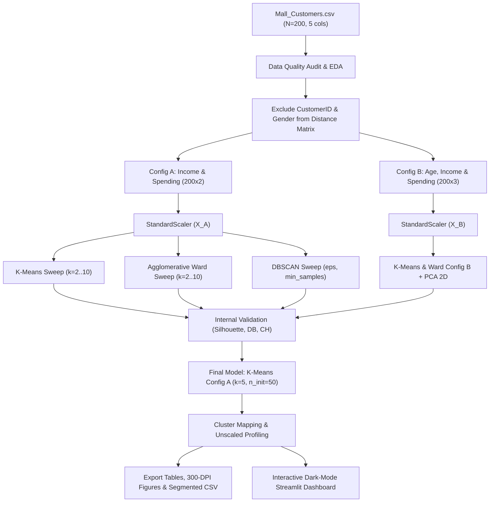

## Model Training & Configuration

Because this is an unsupervised clustering pipeline, models are fitted directly on the standardized feature matrices (`X_A` and `X_B`) without supervised label targets or train/test splitting. All stochastic steps (`KMeans` and `PCA`) use `RANDOM_STATE = 42` for deterministic convergence.

| Parameter / Setting | Experiment Sweep Value | Final Selected Model Value |
| :--- | :--- | :--- |
| Primary Algorithm | `KMeans`, `AgglomerativeClustering`, `DBSCAN` | `KMeans` |
| Feature Configuration | Config A (2D) & Config B (3D) | Config A (`Annual Income`, `Spending Score`) |
| Number of Clusters (`k`) | `2` to `10` | `5` |
| Centroid Restarts (`n_init`) | `25` | `50` |
| Random Seed (`random_state`) | `42` | `42` |
| Scaling Method | `StandardScaler` ($\mu = 0, \sigma = 1$) | `StandardScaler` ($\mu = 0, \sigma = 1$) |
| Linkage (Hierarchical) | `ward` | `ward` (validation benchmark) |
| DBSCAN Grid | `eps` $\in [0.25, 0.50]$, `min_samples` $\in [3, 8]$ | `eps=0.35`, `min_samples=5` (exploratory plot) |

```python
scaler_A = StandardScaler()
X_A = scaler_A.fit_transform(df[['Annual Income (k$)', 'Spending Score (1-100)']])
final_kmeans = KMeans(n_clusters=5, random_state=42, n_init=50)
raw_labels = final_kmeans.fit_predict(X_A)
```

## Hyperparameter Tuning & Experiment Tracking

Hyperparameter search was executed programmatically across $k \in [2, 10]$ for K-Means and Agglomerative Clustering on both feature spaces, plus a 35-run grid over `eps` $\in \{0.25, 0.30, 0.35, 0.38, 0.40, 0.45, 0.50\}$ and `min_samples` $\in \{3, 4, 5, 6, 8\}$ for DBSCAN, with all run logs persisted to CSV and Markdown files in `tables/`.

| Experiment Series | Configuration | Search Space | Best Parameter | Peak Silhouette |
| :--- | :--- | :--- | :--- | ---: |
| K-Means Config A | `Annual Income`, `Spending Score` | $k \in [2, 10]$, `n_init=25` | `k = 5` | `0.5547` |
| K-Means Config B | `Age`, `Annual Income`, `Spending Score` | $k \in [2, 10]$, `n_init=25` | `k = 6` | `0.4284` |
| Ward Hierarchical Config A | `Annual Income`, `Spending Score` | $k \in [2, 10]$, `linkage='ward'` | `k = 5` | `0.5538` |
| Ward Hierarchical Config B | `Age`, `Annual Income`, `Spending Score` | $k \in [2, 10]$, `linkage='ward'` | `k = 6` | `0.4201` |
| DBSCAN Config A | `Annual Income`, `Spending Score` | 35 `(eps, min_samples)` pairs | `eps = 0.35, min_samples = 5` | `0.5577` (core, 23 noise pts) |

## Model Comparison & Selection

Model selection balanced mathematical cluster cohesion against business coverage (retaining 100% of customers without discarding valid patrons as noise). K-Means on Configuration A ($k = 5$) achieved the lowest Davies-Bouldin Index (`0.5722`) and highest Calinski-Harabasz Index (`248.65`) among full-coverage models, closely corroborated by Ward Hierarchical linkage (`0.5538` Silhouette).

| Algorithm | Features | Clusters ($k$) | Silhouette Score | Davies-Bouldin Index | Calinski-Harabasz Index | Cluster Sizes | Decision |
| :--- | :--- | :---: | ---: | ---: | ---: | :--- | :--- |
| **K-Means** | Config A (Income, Spending) | **5** | **0.5547** | **0.5722** | **248.65** | `[81, 39, 35, 22, 23]` | **Selected as Final Model** |
| Agglomerative (Ward) | Config A (Income, Spending) | 5 | 0.5538 | 0.5779 | 244.41 | `[85, 39, 32, 23, 21]` | Alternative Validation |
| K-Means | Config B (Age, Income, Spending) | 6 | 0.4284 | 0.8254 | 135.10 | `[45, 39, 39, 33, 23, 21]` | Evaluated Supporting Model |
| Agglomerative (Ward) | Config B (Age, Income, Spending) | 6 | 0.4201 | 0.8521 | 127.99 | `[45, 45, 39, 28, 22, 21]` | Supporting Comparison |
| DBSCAN | Config A (Income, Spending) | 6 + noise | 0.5577 (core) | 0.6320 (core) | 214.50 (core) | Noise: 23, Clustered: 177 | Rejected (11.5% noise loss) |

## Model Evaluation & Results

Internal cluster validation computed across the full standardized Configuration A matrix ($N = 200$) confirms strong geometric separation at $k = 5$. Incorporating `Age` in Configuration B reduced peak Silhouette Score to `0.4284` ($k = 6$) and `0.4166` ($k = 5$), demonstrating that age introduces continuous dispersion better suited for post-clustering demographic profiling than distance computation.

| Cluster ID | Segment Name | Count ($n$) | Share (%) | Mean Age | Mean Income | Mean Spending | Female / Male (%) |
| :---: | :--- | ---: | ---: | ---: | ---: | ---: | :---: |
| **0** | Balanced Middle-Income | 81 | 40.5% | 42.7 yrs | \$55.3k | 49.5 / 100 | 59.3% / 40.7% |
| **1** | Affluent VIP Spenders | 39 | 19.5% | 32.7 yrs | \$86.5k | 82.1 / 100 | 53.8% / 46.2% |
| **2** | Frugal High-Earners | 35 | 17.5% | 41.1 yrs | \$88.2k | 17.1 / 100 | 45.7% / 54.3% |
| **3** | Youthful Impulsive Spenders | 22 | 11.0% | 25.3 yrs | \$25.7k | 79.4 / 100 | 59.1% / 40.9% |
| **4** | Prudent Budget Shoppers | 23 | 11.5% | 45.2 yrs | \$26.3k | 20.9 / 100 | 60.9% / 39.1% |

- **Cluster Separation & Stability:** Configuration A K-Means ($k = 5$) achieved **Silhouette = 0.5547**, **Davies-Bouldin = 0.5722**, **Calinski-Harabasz = 248.65**, and **Inertia = 65.57**, matching Ward Hierarchical clustering (`0.5538` Silhouette) in structural partitioning.
- **Demographic Insights:** Cluster 1 (`Affluent VIP Spenders`) averages `32.7` years with high spend (`82.1`), Cluster 2 (`Frugal High-Earners`) represents the highest income (`$88.2k`) with the lowest spend (`17.1`) and is the only Male-majority segment (`54.3%`), and Cluster 3 (`Youthful Impulsive Spenders`) is the youngest cohort (`25.3` years).
- **Study Limitations:** Cross-sectional sample size is limited to $N = 200$ customers without longitudinal Recency, Frequency, and Monetary (RFM) transaction history, and the `Spending Score (1-100)` weighting formula is externally assigned.

## Results Visualization & Preview

### 1. Streamlit Dashboard — Clustering Results & Geometric Space
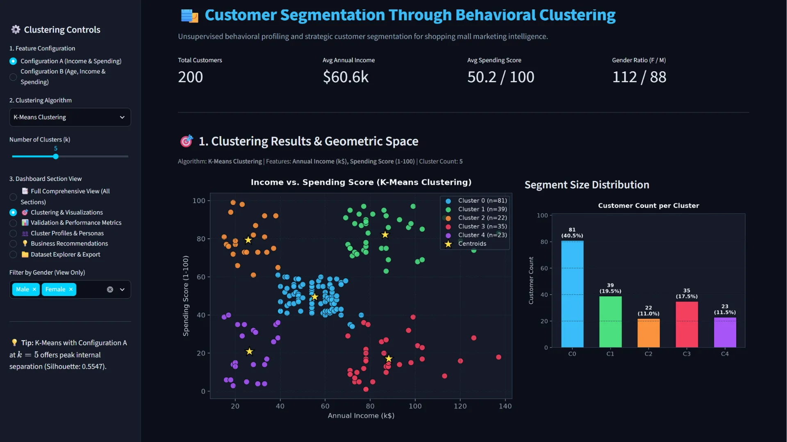
Interactive dark-mode Streamlit view displaying the K-Means ($k = 5$) Configuration A scatter partition of Annual Income versus Spending Score with yellow star centroids alongside the segment size bar chart (`40.5%` Cluster 0 through `11.0%` Cluster 2/3 depending on raw label order). The layout demonstrates clean visual separation across the four behavioral quadrants and central middle-income core.

### 2. Streamlit Dashboard — Internal Cluster Validation Metrics
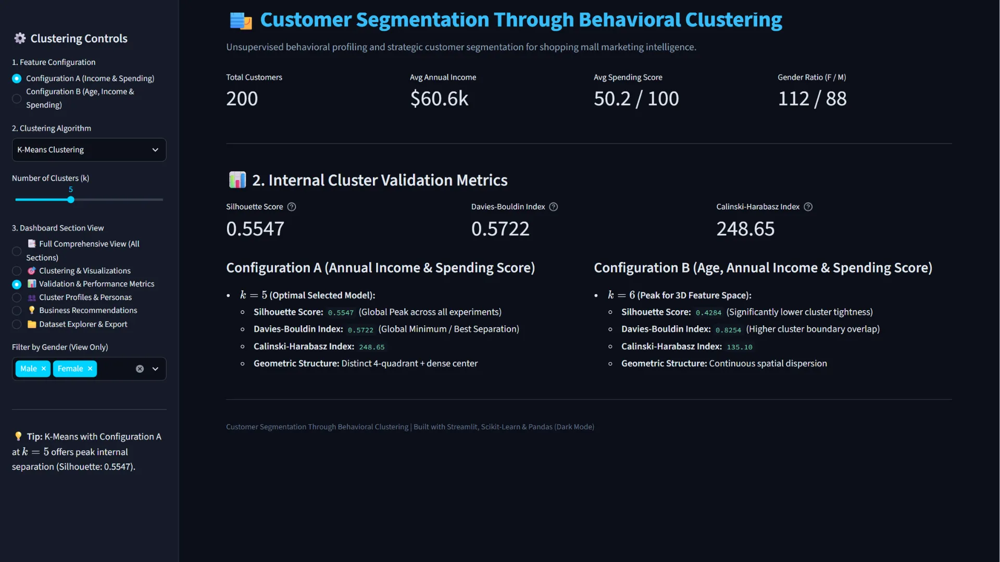
Validation metric comparison panel contrasting the selected Configuration A model ($k = 5$: Silhouette `0.5547`, Davies-Bouldin `0.5722`, Calinski-Harabasz `248.65`) against the peak 3D Configuration B model ($k = 6$: Silhouette `0.4284`, Davies-Bouldin `0.8254`, Calinski-Harabasz `135.10`). The side-by-side summary highlights the tighter geometric cohesion achieved by excluding `Age` from distance calculations.

### 3. Streamlit Dashboard — Cluster Demographic & Behavioral Personas
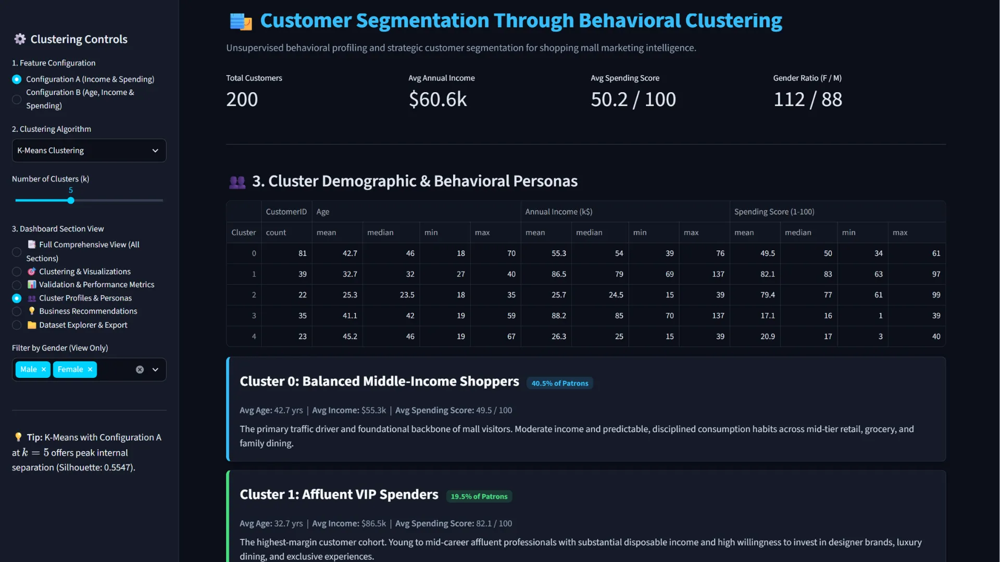
Statistical aggregation table and color-coded persona cards presenting count, mean, median, minimum, and maximum statistics across Age, Annual Income, and Spending Score for every cluster. The persona summaries translate raw numerical centroids into executive-ready customer profiles for Cluster 0 (`Balanced Middle-Income Shoppers`) and Cluster 1 (`Affluent VIP Spenders`).

### 4. Streamlit Dashboard — Targeted Marketing & Engagement Playbook
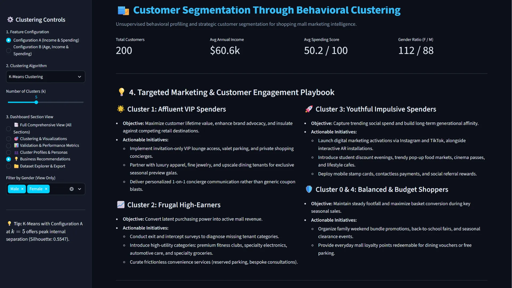
Actionable strategic playbook aligning each discovered behavioral cluster with concrete retail initiatives, such as concierge VIP lounges for Cluster 1, premium utility services for Cluster 2, social-media and student pop-up activations for Cluster 3, and family loyalty promotions for Clusters 0 and 4.

### 5. Streamlit Dashboard — Customer Dataset Explorer & Export
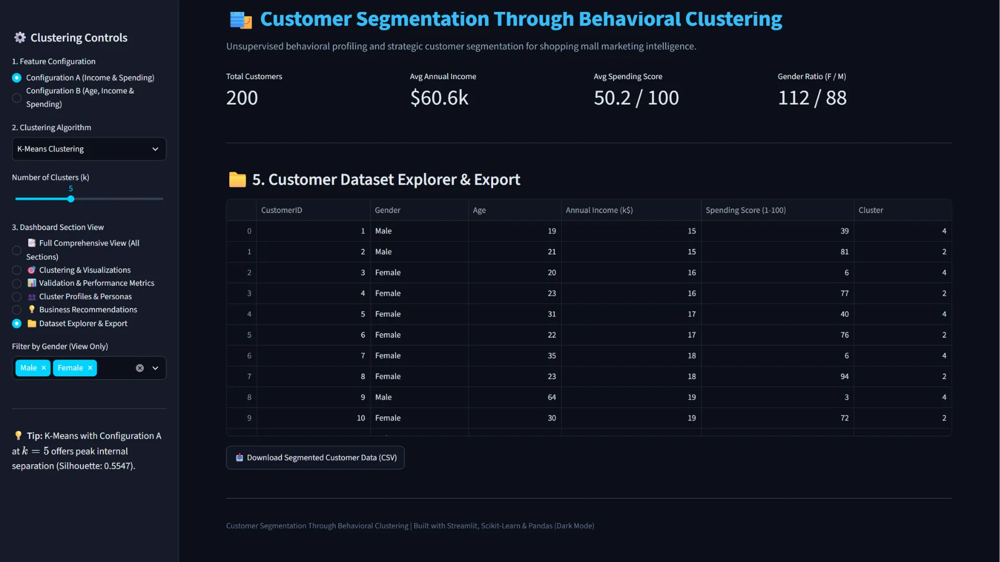
Interactive tabular explorer allowing stakeholders to filter segmented customer records by `Gender` and inspect assigned cluster labels alongside `CustomerID`, `Age`, `Annual Income (k$)`, and `Spending Score (1-100)`. Includes a one-click CSV export control (`segmented_mall_customers.csv`) for downstream CRM or campaign workflows.

### 6. DBSCAN k-Distance Knee Plot & Density Clustering Result
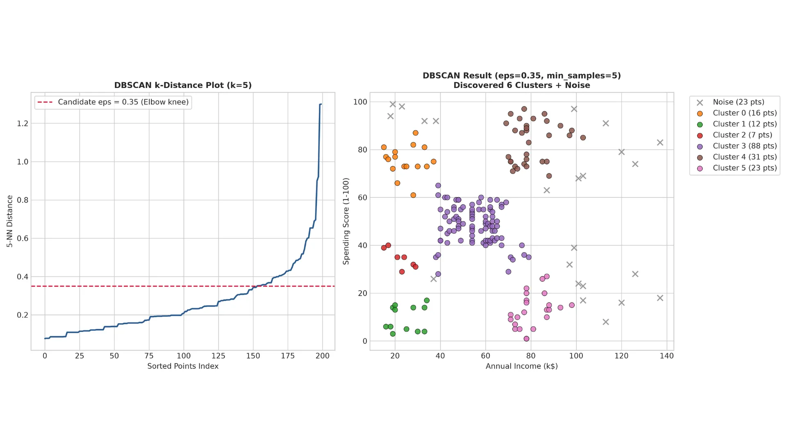
Left: Sorted 5-nearest-neighbor distance curve (`k = 5`) identifying the candidate density knee at $\varepsilon = 0.35$. Right: Resulting DBSCAN partition (`eps = 0.35`, `min_samples = 5`) discovering 6 fragments while classifying 23 valid customers (`11.5%`) as noise due to uneven spatial density between the dense center and sparse high-income periphery.

### 7. Configuration B High-Dimensional PCA Projection & 3D Cluster Space
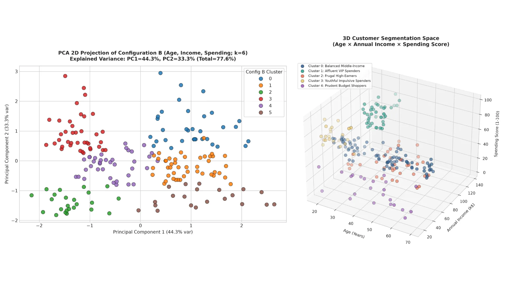
Left: 2D PCA projection of Configuration B ($k = 6$), capturing `77.6%` cumulative variance (`PC1 = 44.3%`, `PC2 = 33.3%`) and showing increased boundary overlap when `Age` is included. Right: 3D scatter visualization across `Age`, `Annual Income (k$)`, and `Spending Score (1-100)` illustrating how age spreads clusters vertically while economic separation remains anchored on the income-spending plane.

### 8. Raw Gender Distribution vs. Final K-Means (k=5) Segments
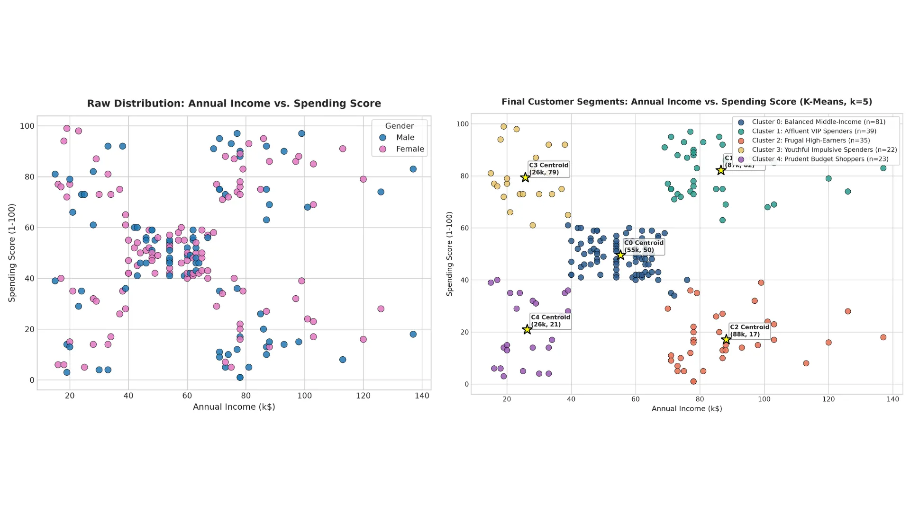
Side-by-side comparison contrasting the raw bivariate scatter colored by `Gender` (left) against the final K-Means ($k = 5$) segmentation with labeled centroids (`C0` through `C4`, right). The raw plot confirms that Male and Female shoppers intermingle across all five natural density regions rather than clustering by gender.

### 9. Numeric Feature Distributions & Elbow Curves (Config A vs. Config B)
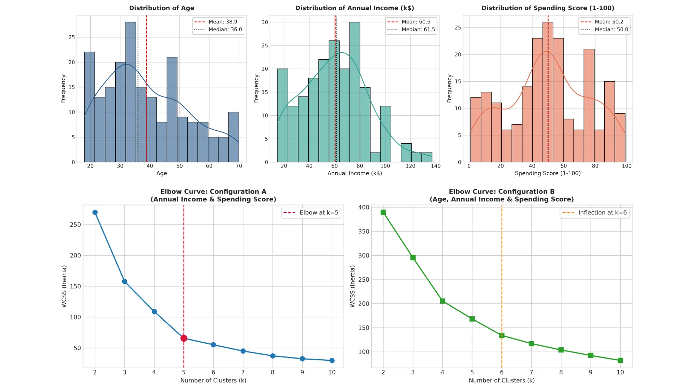
Top: Univariate histograms with KDE curves for `Age` (mean `38.9`, median `36.0`), `Annual Income (k$)` (mean `60.6`, median `61.5`), and `Spending Score (1-100)` (mean `50.2`, median `50.0`), showing a tri-modal tendency in spending behavior. Bottom: WCSS Elbow curves confirming a sharp inflection at $k = 5$ (`65.57` inertia) for Configuration A compared with a gentler slope at $k = 6$ for Configuration B.

### 10. Validation Curves, Correlation Matrix & Standardized Z-Score Profile
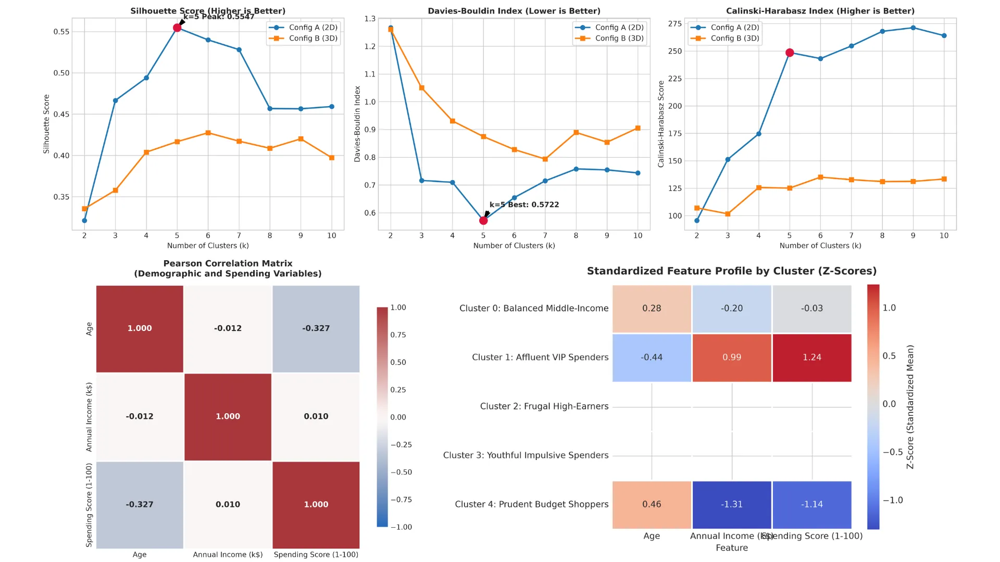
Top: Multi-metric evaluation curves across $k \in [2, 10]$ proving that Configuration A peaks globally at $k = 5$ on Silhouette (`0.5547`) and minimizes Davies-Bouldin (`0.5722`). Bottom: Pearson correlation matrix (`Age` vs. `Spending Score` $r = -0.327$; `Annual Income` vs. `Spending Score` $r = 0.010$) paired with the standardized cluster Z-score profile view highlighting distinct positive income/spending signatures for VIPs (`+0.99`, `+1.24`) and negative spending signatures for budget shoppers (`-1.14`).

### 11. Gender Composition & Hierarchical Ward Dendrogram
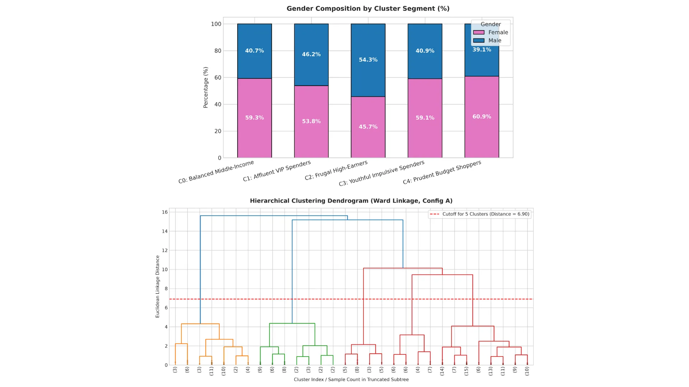
Top: Stacked percentage bar chart showing female majority across Clusters 0 (`59.3%`), 3 (`59.1%`), and 4 (`60.9%`), near parity in Cluster 1 (`53.8%` Female), and a male majority in Cluster 2 (`54.3%` Male). Bottom: Truncated Ward linkage dendrogram for Configuration A showing a clean horizontal cut at Euclidean distance `6.90` that independently recovers 5 clusters (`0.5538` Silhouette).

### 12. Original-Scale Cluster Mean Comparisons & Segment Proportions
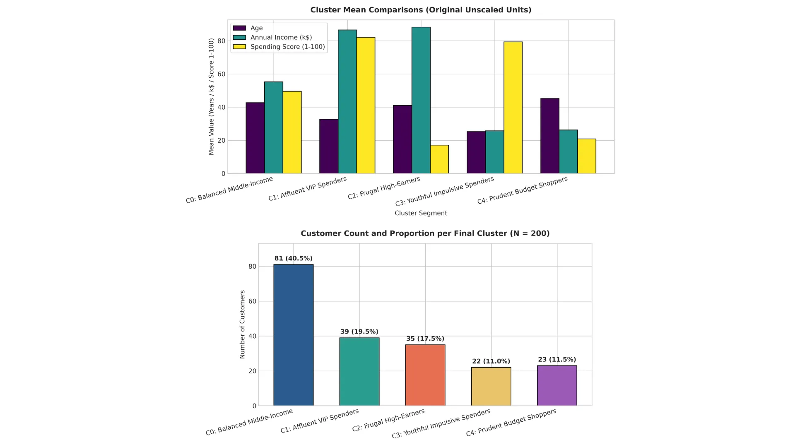
Top: Grouped bar chart comparing unscaled cluster means across `Age`, `Annual Income (k$)`, and `Spending Score (1-100)`, highlighting the contrast between high-income/high-spend VIPs (`C1`) and high-income/low-spend Frugal High-Earners (`C2`). Bottom: Final segment volume distribution across $N = 200$ customers, led by `C0: Balanced Middle-Income` (`81`, `40.5%`) and `C1: Affluent VIP Spenders` (`39`, `19.5%`).

## Prerequisites

- **Operating System:** Windows, macOS, or Linux (CPU execution fully supported; no GPU required).
- **Python:** Python `3.10+` (verified in project report on Windows 11 with Python `3.15.1`).
- **Package Manager:** `pip` with virtual environment support (`venv`).
- **Dataset:** Local CSV file located at [dataset/original/Mall_Customers.csv](dataset/original/Mall_Customers.csv).
- **Core Libraries:** `pandas>=2.2.0`, `numpy>=1.26.0`, `scikit-learn>=1.4.0`, `scipy>=1.12.0`, `matplotlib>=3.8.0`, `seaborn>=0.13.0`, `streamlit>=1.35.0`, `tabulate>=0.9.0` (listed in [requirements.txt](requirements.txt)).

## Installation & Setup

1. Clone the repository and navigate into the project directory:
   ```bash
   git clone https://github.com/weztcy/Customer-Segmentation-Through-Behavioral-Clustering.git
   cd "Customer Segmentation Through Behavioral Clustering"
   ```
2. Create and activate a Python virtual environment:
   ```bash
   python -m venv .venv
   # Windows PowerShell
   .\.venv\Scripts\Activate.ps1
   # macOS / Linux
   source .venv/bin/activate
   ```
3. Install all required dependencies from [requirements.txt](requirements.txt):
   ```bash
   pip install -r requirements.txt
   ```

## Usage & Execution

The project provides both a batch modeling script ([src/customer_segmentation.py](src/customer_segmentation.py)) that generates all figures and metric tables, and an interactive dark-mode web dashboard ([streamlit/app.py](streamlit/app.py)). Note that both scripts check for `Mall_Customers.csv` in the repository root or `dataset/Mall_Customers.csv`, whereas the repository stores the original file at `dataset/original/Mall_Customers.csv`.

1. Ensure `Mall_Customers.csv` is accessible at `dataset/Mall_Customers.csv` (or the repository root) before executing scripts:
   ```bash
   cp dataset/original/Mall_Customers.csv dataset/Mall_Customers.csv
   ```
2. Execute the full clustering, evaluation, and visualization pipeline:
   ```bash
   python src/customer_segmentation.py
   ```
   This regenerates all 14 analytical plots under `outputs/figures/` and all CSV/Markdown metric tables under `outputs/tables/`.
3. Launch the interactive Streamlit dashboard (configured with dark mode in [.streamlit/config.toml](.streamlit/config.toml)):
   ```bash
   python -m streamlit run streamlit/app.py
   ```
   Open `http://localhost:8501` in a browser to switch between Configuration A/B, tune K-Means/Hierarchical/DBSCAN parameters, inspect cluster personas, and download segmented CSVs.

## Reproducibility & Execution

All clustering and dimensionality reduction computations in [src/customer_segmentation.py](src/customer_segmentation.py) and [streamlit/app.py](streamlit/app.py) are deterministically seeded with `random_state=42` (`np.random.seed(42)`) so repeated runs on `Mall_Customers.csv` yield identical centroids, Silhouette scores, and segment counts.

1. Pin or install the exact dependency lower bounds specified in [requirements.txt](requirements.txt).
2. Keep `RANDOM_STATE = 42` unmodified in [src/customer_segmentation.py](src/customer_segmentation.py) and `n_init = 50` for the final `KMeans` fit.
3. Run `python src/customer_segmentation.py` from the repository root with `dataset/Mall_Customers.csv` in place to reproduce the benchmark metrics reported in [tables/model_comparison_decision.csv](tables/model_comparison_decision.csv) and [tables/final_cluster_profiles.csv](tables/final_cluster_profiles.csv).
4. Note that minor floating-point formatting or matplotlib layout rendering differences may occur across different OS/library patch versions without altering cluster assignments.

## Contributing

Contributions that improve analytical clarity, dashboard responsiveness, or test coverage are welcome. Please follow this standard workflow:

1. Fork the repository.
2. Create a feature branch for your change (`git checkout -b feature/your-change`).
3. Make your changes and update relevant documentation.
4. Run `python src/customer_segmentation.py` and verify the Streamlit app launches cleanly without errors.
5. Commit and push the branch to your fork.
6. Open a pull request with a clear explanation of the changes.

## License

This project is licensed under the MIT License.
See the [LICENSE](LICENSE) file for details.

## Author & Contact

**Yohanes Dimas Pratama**

- GitHub: [github.com/weztcy](https://github.com/weztcy)
- Portfolio: [yohanesdimas.com](https://yohanesdimas.com)
- LinkedIn: [linkedin.com/in/yohanes-dimas](https://www.linkedin.com/in/yohanes-dimas)
