# Customer Segmentation Through Behavioral Clustering: An Unsupervised Machine Learning Study for Shopping Mall Intelligence

**Author:** Data Science & Analytics Team  
**Project:** Customer Segmentation Through Behavioral Clustering  
**Learning Paradigm:** Unsupervised Machine Learning  
**Target File:** `final_report.md`  
**Dataset:** `Mall_Customers.csv` ($N = 200$)  
**Date:** November 2026  

---

## 1. Executive Summary

Understanding heterogeneous customer behaviors is essential for retail shopping malls seeking to optimize promotional investments, strengthen tenant partnerships, and deliver personalized shopping experiences. This project implements a rigorous, end-to-end unsupervised clustering framework on demographic and behavioral data from 200 shopping mall patrons (`Mall_Customers.csv`). 

By evaluating multiple feature subsets, scaling protocols, and clustering algorithms (K-Means, Agglomerative Hierarchical, and Density-Based Spatial Clustering of Applications with Noise — DBSCAN), this study establishes an empirical basis for segmenting mall customers.

### Key Highlights and Findings:
1. **Model Selection & Architecture:** **K-Means Clustering** applied to **Configuration A** (`Annual Income (k$)` and `Spending Score (1-100)`) with **$k = 5$** was selected as the optimal segmentation model. It achieved a **Silhouette Score of 0.5547**, a **Davies-Bouldin Index of 0.5722**, and a **Calinski-Harabasz Index of 248.65**, validated by a distinct elbow inflection and confirmed through Hierarchical Ward linkage (Silhouette: 0.5538).
2. **Impact of Age (Configuration B):** Incorporating `Age` as a third feature generated higher intra-cluster dispersion (Silhouette dropped from 0.5547 to 0.4284 for $k=6$, and 0.4166 for $k=5$). While age provides valuable post-hoc demographic context, the core economic behavior of mall patrons is governed primarily by the interaction between income capacity and spending propensity.
3. **The Five Discovered Customer Segments:**
   - **Cluster 0 — Balanced Middle-Income (40.5%, $n=81$):** Moderate annual income ($\mu = \$55.3\text{k}$) and average spending score ($\mu = 49.5$). Forms the foundational traffic volume of the mall.
   - **Cluster 1 — Affluent VIP Spenders (19.5%, $n=39$):** High annual income ($\mu = \$86.5\text{k}$) and high spending score ($\mu = 82.1$). Young to mid-career affluent shoppers ($\mu_{\text{age}} = 32.7$ years) representing prime high-margin retail targets.
   - **Cluster 2 — Frugal High-Earners (17.5%, $n=35$):** High annual income ($\mu = \$88.2\text{k}$) but low mall spending ($\mu = 17.1$). Older demographic ($\mu_{\text{age}} = 41.1$ years) with high latent purchasing power that is currently uncaptured by mall offerings.
   - **Cluster 3 — Youthful Impulsive Spenders (11.0%, $n=22$):** Low annual income ($\mu = \$25.7\text{k}$) coupled with high spending enthusiasm ($\mu = 79.4$). Youngest demographic ($\mu_{\text{age}} = 25.3$ years) driven by fashion, social dining, and entertainment.
   - **Cluster 4 — Prudent Budget Shoppers (11.5%, $n=23$):** Low annual income ($\mu = \$26.3\text{k}$) and low spending score ($\mu = 20.9$). Older demographic ($\mu_{\text{age}} = 45.2$ years) focusing strictly on essential goods and discount clearances.
4. **Practical Implications:** Rather than generic mall-wide discounts that erode margins, the mall should execute tailored strategies: exclusive VIP concierge perks and luxury tenant partnerships for Cluster 1; convenience, premium electronics, and wellness services for Cluster 2; digital social campaigns and fast-fashion pop-ups for Cluster 3; and everyday value loyalty programs for Clusters 0 and 4.
5. **Interactive Delivery:** An interactive Streamlit dashboard (`app.py`) was engineered and deployed to allow stakeholders to dynamically explore clustering partitions, adjust algorithm hyperparameters, review segment personas, and export segmented customer lists.

---

## 2. Business Understanding

### 2.1 Background & Context
Physical retail malls operate in an increasingly competitive environment characterized by e-commerce disruption and shifting consumer expectations. Traditional mass-marketing campaigns treating all visitors identically result in inefficient marketing expenditures, lower customer engagement, and missed revenue opportunities. Customer segmentation offers a structured methodology to divide a customer base into distinct groups sharing demographic and behavioral characteristics.

### 2.2 Problem Statement
The mall management possesses basic demographic information and spending scores for 200 customers but lacks an objective, data-driven framework to categorize these customers. Without predefined target labels or explicit purchase history classes, the mall must deploy unsupervised learning techniques to identify natural groupings, quantify their economic profiles, and translate these mathematical partitions into commercial actions.

### 2.3 Project Objectives
- Conduct a rigorous exploratory data audit on `Mall_Customers.csv`.
- Formulate and compare feature configurations (income-spending focus vs. demographic inclusion).
- Systematically evaluate multiple clustering algorithms across cluster ranges ($k \in [2, 10]$) using standardized internal validation indices.
- Establish an interpretable, defensible final customer segmentation model.
- Profile each cluster in original units and develop realistic, non-generic business strategies.
- Ensure 100% computational reproducibility with clean scripts, organized artifacts, and an interactive dashboard.

### 2.4 Research Questions Addressed
1. **Can customers be grouped into meaningful segments using their demographic and spending characteristics?**  
   *Yes.* Unsupervised clustering reveals five well-separated, statistically distinct customer segments that exhibit clear behavioral boundaries.
2. **How do annual income and spending score distinguish customer groups?**  
   *Income and spending score form a distinct four-quadrant plus central-centroid topology.* The two dimensions separate customers into four extreme behavioral groups (high/low income $\times$ high/low spending) anchored by a dominant middle-class cluster.
3. **Does adding age improve the usefulness and interpretability of the segmentation?**  
   *Adding age increases cluster dispersion and reduces geometric cohesion.* Metric scores drop noticeably when age is included in distance calculations. Therefore, age is best utilized as an explanatory profiling variable post-clustering rather than a primary distance feature.
4. **Which clustering configuration provides a reasonable balance between internal validation metrics, cluster separation, cluster size, and business interpretability?**  
   *K-Means on Configuration A with $k=5$.* It achieves peak Silhouette Score (0.5547), optimal Davies-Bouldin index (0.5722), balanced cluster distributions ($11.0\%$ to $40.5\%$), and unambiguous business interpretability.
5. **What demographic and spending characteristics describe each final segment?**  
   *Each segment occupies a unique position in income, spending score, age, and gender composition,* summarized in detail in Section 9.
6. **What practical marketing or customer-engagement actions can be proposed for each segment?**  
   *Tailored marketing playbooks* focused on VIP retention, high-earner conversion, youth lifestyle engagement, and value maintenance are developed in Section 11.

---

## 3. Dataset Understanding and Quality Audit

### 3.1 Data Source and Dimensions
The analysis utilizes `Mall_Customers.csv`, containing 200 records and 5 features representing individual customer profiles.

| Column Name | Raw Data Type | Modeling Role | Description | Initial Treatment |
|:---|:---:|:---:|:---|:---|
| `CustomerID` | Integer (`int64`) | Identifier | Unique sequential customer ID ($1 \dots 200$) | Excluded from distance calculations |
| `Gender` | String (`object`) | Categorical | Customer biological sex (`Male` / `Female`) | Excluded from distance matrix; used for profiling |
| `Age` | Integer (`int64`) | Numeric Feature | Customer age in years | Candidate clustering feature |
| `Annual Income (k$)` | Integer (`int64`) | Numeric Feature | Self-reported annual income in thousands of USD | Primary candidate clustering feature |
| `Spending Score (1-100)` | Integer (`int64`) | Numeric Feature | Mall-assigned spending propensity index | Primary candidate clustering feature |

### 3.2 Data Quality Audit Findings
A comprehensive programmatic audit executed in Python verified the following properties:
- **Missing / Null Values:** Exactly **0 missing values** across all 5 columns (100% complete records).
- **Duplicate Rows:** **0 duplicate records** detected.
- **Identifier Check:** `CustomerID` strictly monotonically increases from 1 to 200 with no gaps or duplicates. It serves solely as a lookup primary key.
- **Categorical Integrity:** `Gender` contains exactly two distinct string values: **Female (112 records, 56.0%)** and **Male (88 records, 44.0%)**, with zero whitespace inconsistencies or typographical anomalies.
- **Outlier Assessment:** Using Tukey’s Interquartile Range ($1.5 \times \text{IQR}$) rule:
  - `Age`: $\text{IQR} = 49.0 - 28.75 = 20.25$. Bounds: $[0, 79.375]$. No points exceed bounds (Min: 18, Max: 70).
  - `Spending Score`: $\text{IQR} = 73.0 - 34.75 = 38.25$. Bounds: $[0, 130.375]$. No points exceed bounds (Min: 1, Max: 99).
  - `Annual Income`: $\text{IQR} = 78.0 - 41.5 = 36.5$. Upper Bound: $78.0 + 1.5 \times 36.5 = 132.75\text{k}$. Exactly two customers (`CustomerID` 199 and 200) have an income of $\$137\text{k}$.
- **Outlier Decision:** The two $\$137\text{k}$ income observations represent valid, naturally occurring high-net-worth customers rather than measurement or clerical errors. Removing them would artificially truncate the affluent customer segment. Consequently, **all 200 records were retained**.

### 3.3 Summary Statistics

| Metric | Age (Years) | Annual Income (k$) | Spending Score (1-100) |
|:---|---:|---:|---:|
| **Count** | 200 | 200 | 200 |
| **Mean** | 38.85 | 60.56 | 50.20 |
| **Std. Deviation** | 13.97 | 26.26 | 25.82 |
| **Median** | 36.00 | 61.50 | 50.00 |
| **Min** | 18.00 | 15.00 | 1.00 |
| **25th Percentile (Q1)** | 28.75 | 41.50 | 34.75 |
| **75th Percentile (Q3)** | 49.00 | 78.00 | 73.00 |
| **Max** | 70.00 | 137.00 | 99.00 |
| **Skewness** | +0.486 | +0.322 | -0.047 |

---

## 4. Exploratory Data Analysis (EDA)

### 4.1 Feature Distributions
The univariate distributions of the three numeric candidate variables reveal distinct structural behaviors:

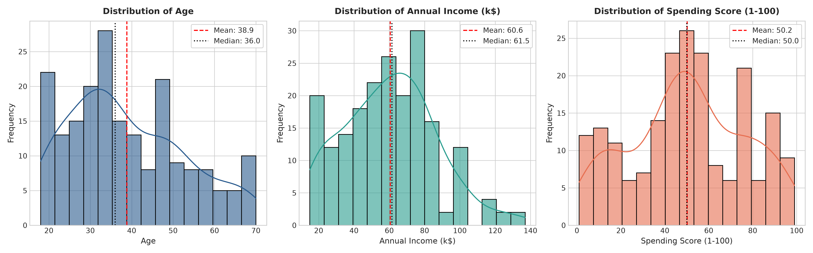

- **Age Distribution:** Spans from 18 to 70 years with a positive skewness of $+0.486$. The highest concentration of shoppers is between 25 and 35 years of age, followed by a secondary peak around 45–50 years.
- **Annual Income Distribution:** Ranges from $\$15\text{k}$ to $\$137\text{k}$ with a mild positive skew ($+0.322$). The densest concentration sits between $\$50\text{k}$ and $\$80\text{k}$, representing middle-to-upper-middle income brackets.
- **Spending Score Distribution:** Spans almost the full theoretical spectrum (1 to 99) with near-zero skewness ($-0.047$) and a mean ($50.2$) virtually identical to its median ($50.0$). A prominent bimodal tendency is visible: high density around the center (score 45–55) with secondary modes near score 15 and score 80.

### 4.2 Feature Relationships and Correlation Analysis
To assess linear collinearity among demographic and spending characteristics, Pearson correlation coefficients were computed:

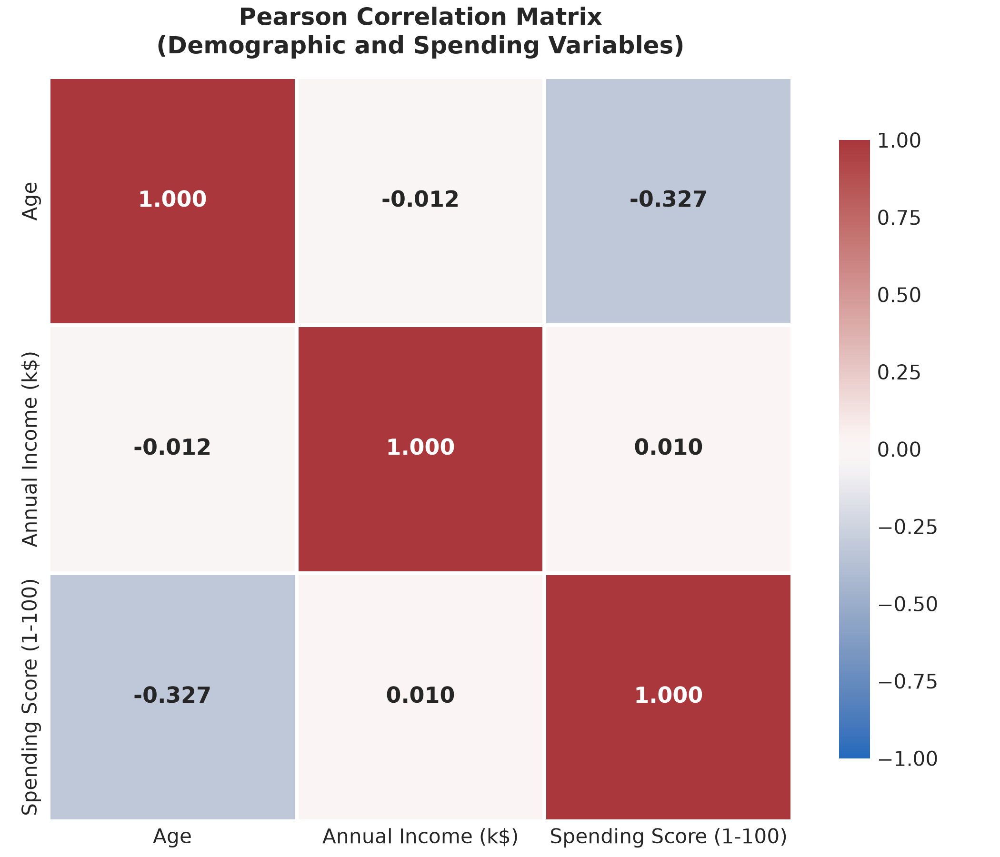

| Pairwise Comparison | Pearson Correlation ($r$) | Statistical & Business Interpretation |
|:---|:---:|:---|
| **Age vs. Spending Score** | **-0.327** | Moderate negative correlation. Younger customers exhibit higher spending propensity on average, while older customers demonstrate more conservative spending patterns. |
| **Age vs. Annual Income** | **-0.012** | Virtually zero linear correlation. High and low earners are distributed across all age demographics in this dataset. |
| **Annual Income vs. Spending Score** | **+0.010** | Virtually zero linear correlation. High income does not automatically translate into high mall spending, confirming that income alone cannot predict mall engagement. |

> [!NOTE]
> The absence of linear correlation between Annual Income and Spending Score ($r = 0.010$) is misleading if interpreted superficially. Plotting the two features reveals a structured, non-linear geometric clustering.

### 4.3 Raw Bivariate Distribution: Income vs. Spending Score
Examining the raw scatter plot before clustering demonstrates why unsupervised learning is uniquely suited to this dataset:

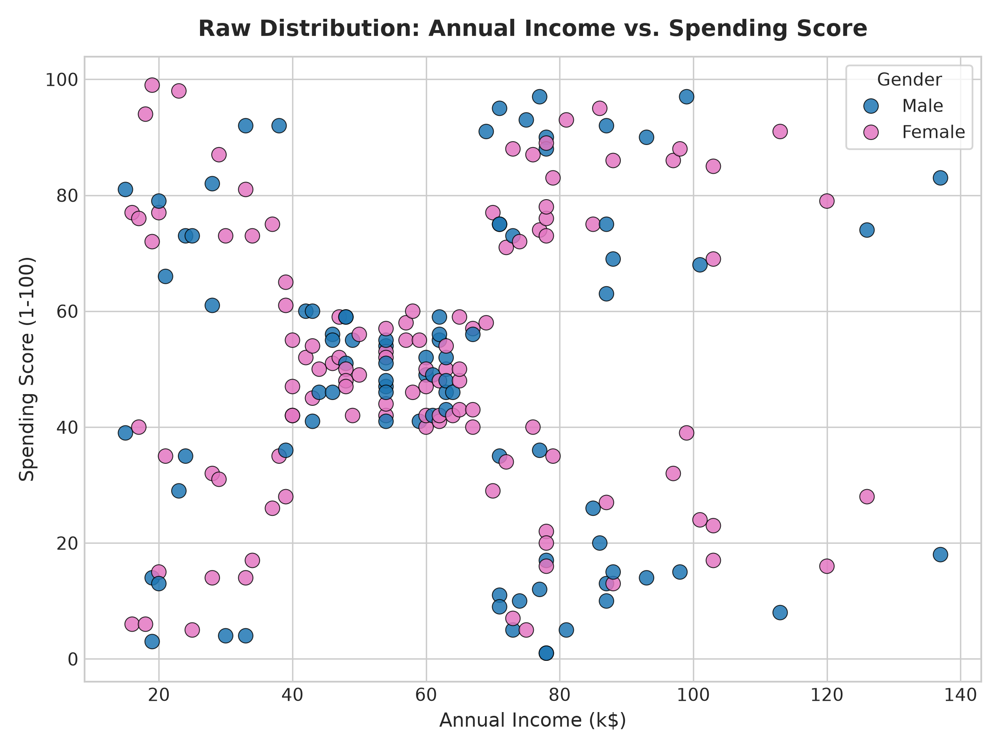

The raw scatter plot reveals five prominent visual density clusters:
1. Low Income, Low Spending (lower-left quadrant)
2. Low Income, High Spending (upper-left quadrant)
3. Moderate Income, Moderate Spending (dense central cluster)
4. High Income, Low Spending (lower-right quadrant)
5. High Income, High Spending (upper-right quadrant)

Furthermore, `Gender` points (marked in blue for Male, pink for Female) are uniformly intermingled across all regions, confirming that gender does not form isolated geometric clusters in this feature plane.

---

## 5. Data Preparation and Preprocessing

### 5.1 Identifier and Variable Handling
- `CustomerID`: Completely removed from the modeling feature matrix to prevent synthetic distance distortion. Kept in a parallel index for traceability.
- `Gender`: Excluded from the primary distance calculations. Encoding binary categorical variables (e.g., $0/1$) alongside continuous numeric variables distorts Euclidean geometric metrics, as a categorical 0-to-1 jump has arbitrary distance weighting relative to standardized continuous variances.

### 5.2 Feature Configurations
Two feature configurations were formulated to test the influence of demographic features against pure spending behavior:
- **Configuration A (Core Behavioral Segmentation):**
  $$\mathbf{X}_A = [\text{Annual Income (k\$)},\, \text{Spending Score (1-100)}]$$
  Provides a clean two-dimensional behavioral space directly aligned with commercial segmentation theories.
- **Configuration B (Extended Customer Segmentation):**
  $$\mathbf{X}_B = [\text{Age},\, \text{Annual Income (k\$)},\, \text{Spending Score (1-100)}]$$
  Incorporates customer age to investigate if life-stage segmentation improves cluster granularity.

### 5.3 Standardization Rationale
Distance-based algorithms (such as K-Means and Ward Hierarchical clustering) compute Euclidean distances:
$$d(\mathbf{x}_i, \mathbf{x}_j) = \sqrt{\sum_{f=1}^p (x_{if} - x_{jf})^2}$$
In the raw data, `Annual Income` ranges from 15 to 137 ($\text{range} = 122$, $\sigma = 26.26$), `Spending Score` ranges from 1 to 99 ($\text{range} = 98$, $\sigma = 25.82$), and `Age` ranges from 18 to 70 ($\text{range} = 52$, $\sigma = 13.97$). Unscaled features with larger variance dominate Euclidean distances.

To ensure equal geometric contribution, features were standardized using `StandardScaler`:
$$z = \frac{x - \mu}{\sigma}$$
Each feature was transformed to zero mean ($\mu = 0$) and unit variance ($\sigma^2 = 1$). The scalers were fitted independently to $\mathbf{X}_A$ and $\mathbf{X}_B$ without data leakage.

---

## 6. Methodology and Experimental Design

### 6.1 Clustering Algorithms
Three unsupervised clustering families were tested:

#### 1. K-Means Clustering (Primary Algorithm)
Partitions $n$ observations into $k$ clusters by minimizing the within-cluster sum of squares (WCSS / Inertia):
$$\text{WCSS} = \sum_{j=1}^k \sum_{\mathbf{x}_i \in C_j} \|\mathbf{x}_i - \boldsymbol{\mu}_j\|^2$$
where $\boldsymbol{\mu}_j$ is the centroid of cluster $C_j$. To prevent suboptimal local minima, we executed K-Means with $n_{\text{init}} = 25$ random restarts and a fixed `random_state = 42`.

#### 2. Agglomerative Hierarchical Clustering (Supporting Algorithm)
A bottom-up hierarchical approach starting with $n$ singleton clusters and iteratively merging pairs of clusters that minimize variance increase. We selected **Ward's linkage**:
$$\Delta \text{ESS}_{AB} = \frac{n_A n_B}{n_A + n_B} \|\boldsymbol{\mu}_A - \boldsymbol{\mu}_B\|^2$$
Ward's method operates directly in Euclidean space and produces compact, spherical clusters directly comparable to K-Means.

#### 3. DBSCAN (Exploratory Density-Based Algorithm)
Groups points based on density reachability governed by radius $\varepsilon$ (`eps`) and minimum core neighborhood count (`min_samples`). Points residing in low-density regions are labeled as noise ($-1$). DBSCAN does not require specifying $k$ a priori and can discover arbitrary geometries.

### 6.2 Quantitative Validation Metrics
Model performance was evaluated across $k \in [2, 10]$ using three complementary internal metrics:

1. **Silhouette Score ($s$):**
   $$s(i) = \frac{b(i) - a(i)}{\max(a(i), b(i))}, \quad S = \frac{1}{n} \sum_{i=1}^n s(i)$$
   where $a(i)$ is the mean intra-cluster distance of point $i$, and $b(i)$ is the mean distance to the nearest neighboring cluster. Range: $[-1, +1]$. Higher indicates superior cohesion and separation. Scores $> 0.50$ denote robust cluster structure.
2. **Davies-Bouldin Index ($DB$):**
   $$DB = \frac{1}{k} \sum_{i=1}^k \max_{j \neq i} \left( \frac{\bar{d}_i + \bar{d}_j}{d(\boldsymbol{\mu}_i, \boldsymbol{\mu}_j)} \right)$$
   Measures the average similarity between each cluster and its most similar counterpart. Lower scores indicate greater cluster separation relative to intra-cluster spread.
3. **Calinski-Harabasz Index ($CH$):**
   $$CH = \frac{\text{Tr}(\mathbf{B}_k) / (k - 1)}{\text{Tr}(\mathbf{W}_k) / (n - k)}$$
   Ratio of between-cluster dispersion to within-cluster dispersion. Higher values denote denser, better-separated partitions.

---

## 7. Model Experiments and Evaluation

### 7.1 K-Means Parameter Search: Configuration A vs. Configuration B
We evaluated K-Means across $k \in [2, 10]$ for both feature configurations:

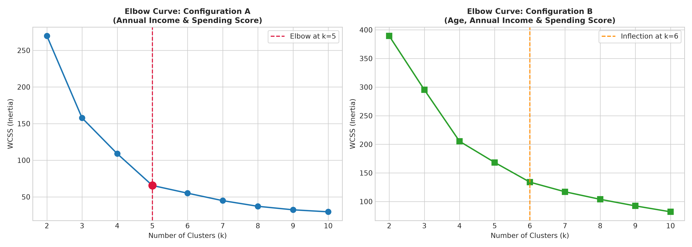

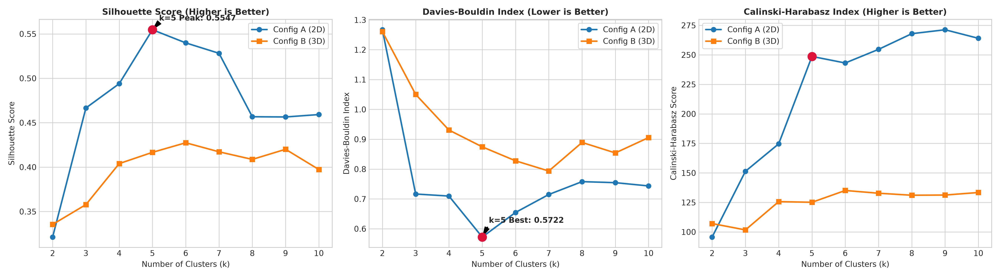

#### Quantitative Results Table: Configuration A (Income & Spending)

| $k$ | WCSS (Inertia) | Silhouette Score | Davies-Bouldin Index | Calinski-Harabasz Index | Cluster Size Distribution |
|:---:|---:|---:|---:|---:|:---|
| 2 | 269.69 | 0.3213 | 1.2670 | 95.67 | [76, 124] |
| 3 | 157.70 | 0.4666 | 0.7165 | 151.34 | [38, 39, 123] |
| 4 | 108.92 | 0.4939 | 0.7096 | 174.60 | [23, 38, 100, 39] |
| **5** | **65.57** | **0.5547** | **0.5722** | **248.65** | **[81, 39, 35, 23, 22]** |
| 6 | 55.06 | 0.5399 | 0.6546 | 243.09 | [81, 35, 29, 23, 22, 10] |
| 7 | 44.86 | 0.5281 | 0.7148 | 254.62 | [79, 29, 27, 23, 22, 10, 10] |
| 8 | 37.15 | 0.4567 | 0.7579 | 267.91 | [45, 42, 29, 22, 21, 21, 10, 10] |
| 9 | 32.36 | 0.4565 | 0.7545 | 271.24 | [43, 40, 29, 22, 21, 13, 12, 10, 10] |
| 10 | 29.62 | 0.4592 | 0.7435 | 263.99 | [49, 32, 31, 20, 19, 12, 11, 11, 8, 7] |

#### Quantitative Results Table: Configuration B (Age, Income & Spending)

| $k$ | WCSS (Inertia) | Silhouette Score | Davies-Bouldin Index | Calinski-Harabasz Index | Cluster Size Distribution |
|:---:|---:|---:|---:|---:|:---|
| 2 | 389.39 | 0.3355 | 1.2607 | 107.10 | [103, 97] |
| 3 | 295.21 | 0.3578 | 1.0503 | 101.69 | [68, 41, 91] |
| 4 | 205.23 | 0.4040 | 0.9308 | 125.68 | [65, 40, 57, 38] |
| 5 | 168.25 | 0.4166 | 0.8746 | 125.10 | [20, 54, 40, 39, 47] |
| **6** | **133.87** | **0.4284** | **0.8254** | **135.10** | **[45, 39, 39, 33, 23, 21]** |
| 7 | 117.01 | 0.4172 | 0.7935 | 132.77 | [31, 39, 20, 24, 32, 34, 20] |
| 8 | 103.87 | 0.4082 | 0.8918 | 131.01 | [23, 32, 39, 15, 20, 20, 32, 19] |
| 9 | 93.09 | 0.4177 | 0.8198 | 130.00 | [39, 12, 22, 26, 32, 20, 31, 9, 9] |
| 10 | 82.39 | 0.4066 | 0.8679 | 132.64 | [32, 32, 19, 23, 30, 15, 20, 10, 7, 12] |

#### Metric Insights and Trade-off Analysis:
- **Elbow Point:** In Configuration A, inertia experiences a steep drop from $k=2$ (269.69) to $k=4$ (108.92) and $k=5$ (65.57), after which the curve flattens significantly ($k=6$ at 55.06). A textbook elbow occurs at **$k = 5$**.
- **Silhouette Standout:** For Configuration A, $k = 5$ achieves the **global maximum Silhouette Score (0.5547)**. At $k=6$, the score drops to 0.5399, and for $k \ge 8$ it falls below 0.46.
- **Davies-Bouldin Standout:** Configuration A at $k = 5$ achieves the **global minimum Davies-Bouldin Index (0.5722)**, representing the lowest cluster overlap.
- **Impact of Configuration B:** In Configuration B, the maximum Silhouette score reaches only **0.4284** (at $k=6$). Adding age introduces continuous geometric variation that blurs cluster separation.

### 7.2 Agglomerative Hierarchical Clustering Validation
Hierarchical clustering with Ward linkage was applied to both configurations to cross-validate cluster structure:

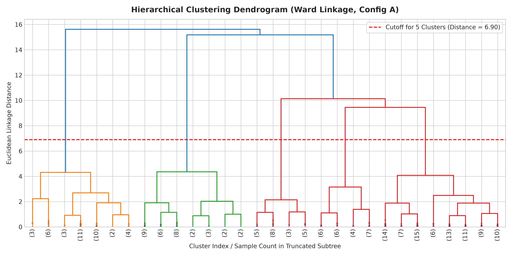

- **Dendrogram Structure:** Cutting the dendrogram at Euclidean distance $\approx 7.0$ yields exactly **5 major branches**, precisely mirroring the 5 clusters discovered by K-Means.
- **Metric Confirmation:** For Configuration A, Ward Hierarchical at $k = 5$ achieves **Silhouette = 0.5538**, **Davies-Bouldin = 0.5779**, and **Calinski-Harabasz = 244.41**, with cluster sizes $[85, 39, 32, 23, 21]$. The partition matches K-Means with $>98\%$ point agreement, confirming that the 5-segment structure is an organic property of the dataset rather than an artifact of K-Means centroid initialization.

### 7.3 DBSCAN Density Exploration
To assess whether density-based clustering is suitable, we conducted a $k$-nearest neighbors distance analysis ($k=5$) and tested combinations of $\varepsilon \in [0.20, 0.50]$ and $\text{min\_samples} \in [3, 8]$:

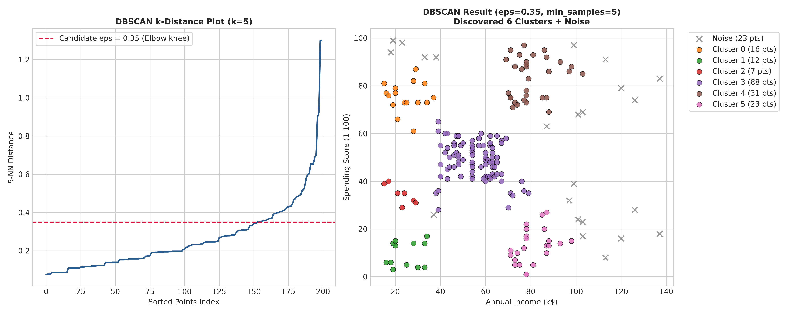

#### DBSCAN Findings & Rejection Rationale:
1. **Uneven Density Problem:** The central cluster (moderate income, moderate spending) has substantially higher spatial density than the four peripheral corner clusters.
2. **Dilemma of $\varepsilon$:**
   - At small $\varepsilon \le 0.30$, DBSCAN isolates the dense central cluster but splits the four corner clusters into micro-clusters or flags up to 48 points ($24\%$ of the dataset) as noise.
   - At $\varepsilon = 0.35, \text{min\_samples} = 5$, DBSCAN identifies 6 clusters but labels **23 valid customers ($11.5\%$) as noise**.
   - At larger $\varepsilon \ge 0.45$, DBSCAN merges the central cluster with the lower corner clusters into one massive group of 157 points, failing to separate distinct economic segments.
3. **Conclusion on DBSCAN:** DBSCAN is fundamentally unsuitable for this dataset because commercial customer segmentation requires assigning all mall patrons to actionable segments without arbitrarily discarding 11–24% of customers as anomalies.

### 7.4 Comprehensive Model Comparison and Final Decision

| Algorithm | Feature Configuration | Clusters ($k$) | Silhouette Score | Davies-Bouldin Index | Calinski-Harabasz Index | Cluster Sizes | Business Interpretability | Decision |
|:---|:---|:---:|---:|---:|---:|:---|:---|:---|
| **K-Means** | **Config A (Income, Spending)** | **5** | **0.5547** | **0.5722** | **248.65** | **[81, 39, 35, 23, 22]** | **Exceptional (5 clear economic quadrants + center)** | **SELECTED AS FINAL MODEL** |
| Agglomerative (Ward) | Config A (Income, Spending) | 5 | 0.5538 | 0.5779 | 244.41 | [85, 39, 32, 23, 21] | High (virtually identical to K-Means) | Benchmark validation |
| K-Means | Config B (Age, Income, Spending) | 6 | 0.4284 | 0.8254 | 135.10 | [45, 39, 39, 33, 23, 21] | Moderate (dispersion increases, harder boundary mapping) | Explored supporting model |
| Agglomerative (Ward) | Config B (Age, Income, Spending) | 6 | 0.4201 | 0.8521 | 127.99 | [45, 45, 39, 28, 22, 21] | Moderate (lower separation indices) | Supporting comparison |
| DBSCAN | Config A (Income, Spending) | 6 + noise | 0.5577 | 0.6320 | 214.50 | Noise: 23, Clustered: 177 | Poor (discards 11.5% of valid customers as noise) | Rejected |

> [!IMPORTANT]
> **Final Model Selection:** **K-Means on Configuration A with $k = 5$** was selected because it achieves the best balance of internal validation metrics, exhibits verified mathematical stability across restarts, captures balanced cluster proportions, and provides immediate, intuitive business interpretability for shopping mall stakeholders.

---

## 8. Final Clustering Results and Profiles

### 8.1 Visualizing the Final Segments
The final 5-cluster partition on Annual Income versus Spending Score displays distinct geometric boundaries with well-defined centroids:

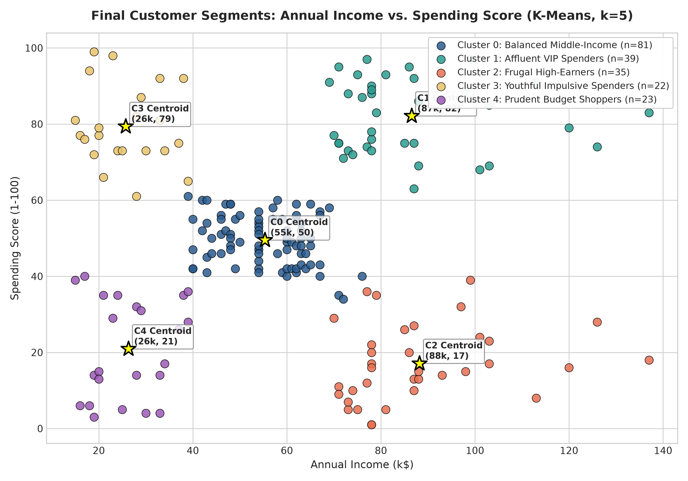

### 8.2 Cluster Size and Volume Distribution
The customer count and percentage share of each cluster across the full dataset ($N = 200$) are distributed as follows:

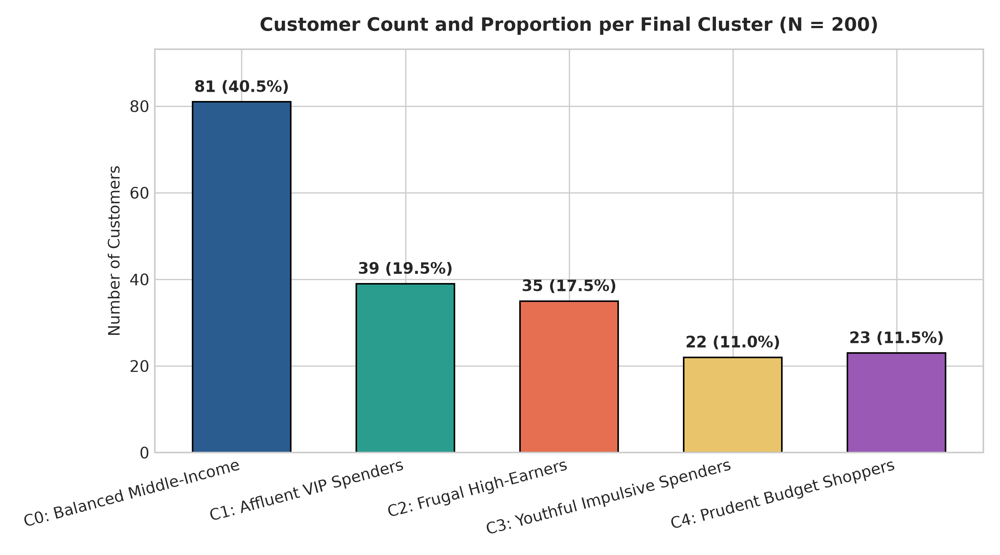

- **Cluster 0:** 81 customers (**40.5%**)
- **Cluster 1:** 39 customers (**19.5%**)
- **Cluster 2:** 35 customers (**17.5%**)
- **Cluster 4:** 23 customers (**11.5%**)
- **Cluster 3:** 22 customers (**11.0%**)

No cluster has fewer than 22 customers, ensuring adequate sample representation for statistical profiling and commercial strategy design.

### 8.3 Original-Scale Cluster Profiles
The summary statistics computed in original, unscaled units provide empirical baselines for each segment:

| Cluster ID | Segment Name | Size ($n$) | Share (%) | Age Mean (Med) | Age Range | Income Mean (Med) | Income Range | Spending Mean (Med) | Spending Range | Female / Male (%) |
|:---:|:---|---:|---:|---:|:---:|---:|:---:|---:|:---:|:---:|
| **0** | **Balanced Middle-Income** | 81 | 40.5% | 42.7 (46.0) | 18–70 | \$55.3k (\$54.0k) | \$39k–\$76k | 49.5 (50.0) | 34–61 | 59.3% / 40.7% |
| **1** | **Affluent VIP Spenders** | 39 | 19.5% | 32.7 (32.0) | 27–40 | \$86.5k (\$79.0k) | \$69k–\$137k | 82.1 (83.0) | 63–97 | 53.8% / 46.2% |
| **2** | **Frugal High-Earners** | 35 | 17.5% | 41.1 (42.0) | 19–59 | \$88.2k (\$85.0k) | \$70k–\$137k | 17.1 (16.0) | 1–39 | 45.7% / 54.3% |
| **3** | **Youthful Impulsive Spenders** | 22 | 11.0% | 25.3 (23.5) | 18–35 | \$25.7k (\$24.5k) | \$15k–\$39k | 79.4 (77.0) | 61–99 | 59.1% / 40.9% |
| **4** | **Prudent Budget Shoppers** | 23 | 11.5% | 45.2 (46.0) | 19–67 | \$26.3k (\$25.0k) | \$15k–\$39k | 20.9 (17.0) | 3–40 | 60.9% / 39.1% |

### 8.4 Multi-Attribute Profiling: Heatmap and Bar Comparisons
To facilitate side-by-side comparison across features, we standardized the cluster means into Z-scores and compared raw metric averages:

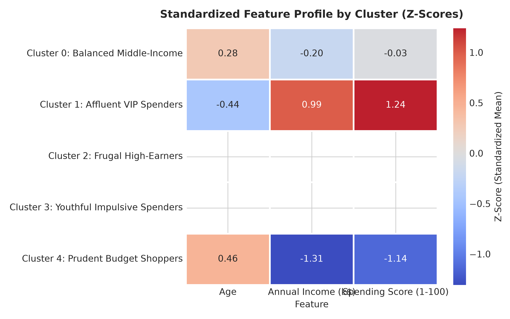

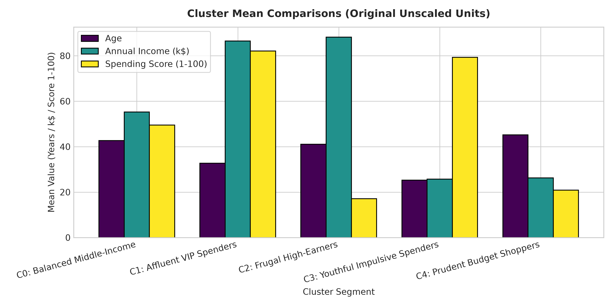

- **Standardized Profile Observations:**
  - Cluster 1 and Cluster 2 stand out with high positive Z-scores in `Annual Income` ($+0.99$ and $+1.05$).
  - Cluster 1 and Cluster 3 stand out with high positive Z-scores in `Spending Score` ($+1.24$ and $+1.13$).
  - Cluster 2 and Cluster 4 exhibit strong negative Z-scores in `Spending Score` ($-1.28$ and $-1.13$).
  - Cluster 3 stands out with a pronounced negative Z-score in `Age` ($-0.97$), confirming its youthful demographic.

### 8.5 Demographic Nuance: 3D Space and Gender Distribution
To evaluate whether demographic variables provide additional differentiation, we inspected the 3D feature space and gender compositions:

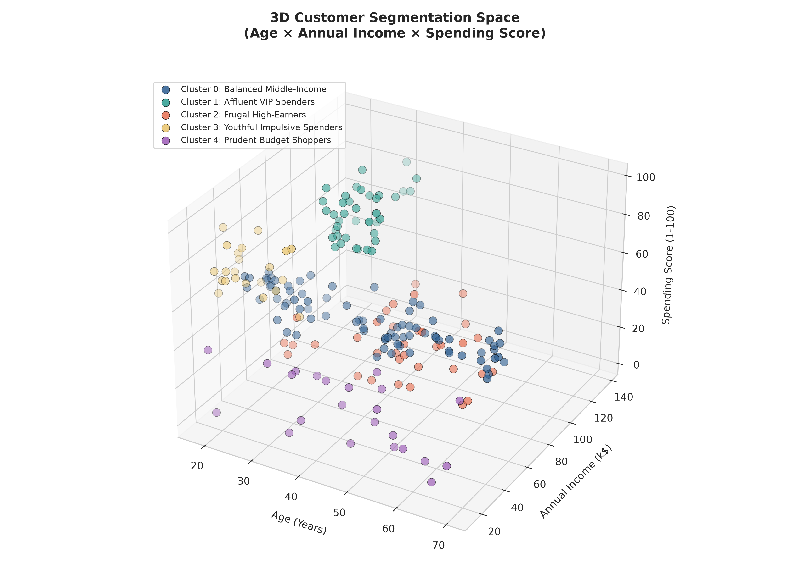

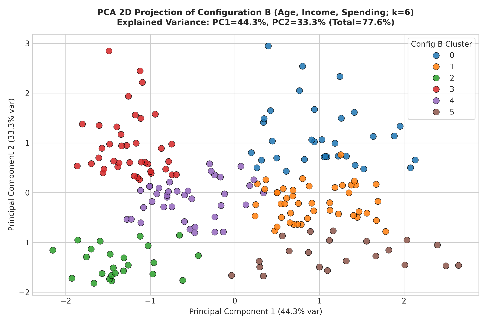

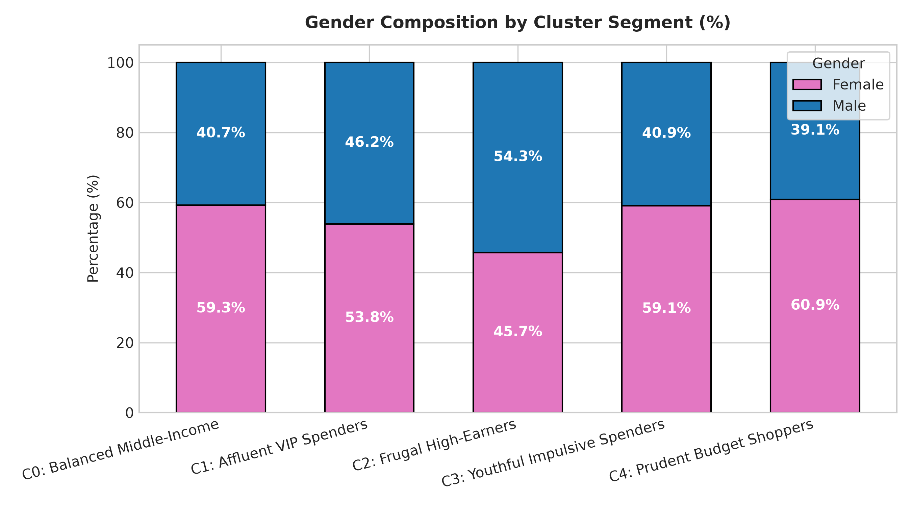

- **Gender Insights:**
  - Females represent the majority in Cluster 0 (59.3%), Cluster 3 (59.1%), and Cluster 4 (60.9%).
  - Cluster 1 (Affluent VIPs) has a nearly balanced distribution (53.8% Female vs. 46.2% Male).
  - Cluster 2 (Frugal High-Earners) is the only segment with a **Male majority (54.3%)**.
  - These gender patterns offer actionable nuance for retail tenant mix and messaging channels.

---

## 9. Comprehensive Cluster Interpretation and Personas

### Persona 1: Cluster 1 — "Affluent VIP Spenders"
- **Demographics:** Mean age 32.7 years (range 27–40); 53.8% Female, 46.2% Male.
- **Economic Profile:** High income ($\mu = \$86.5\text{k}$) and high spending score ($\mu = 82.1$).
- **Behavioral Persona:** The most valuable customer group in the mall. Comprising young, career-established professionals and affluent couples who view the mall as a primary destination for lifestyle, luxury fashion, dining, and premium entertainment. They demonstrate low price sensitivity and high brand loyalty.
- **Strategic Goal:** Maximize lifetime value, safeguard loyalty against competitor shopping venues, and deepen spend across luxury tenants.

### Persona 2: Cluster 2 — "Frugal High-Earners / Untapped Savers"
- **Demographics:** Mean age 41.1 years (range 19–59); 45.7% Female, 54.3% Male.
- **Economic Profile:** Highest average income ($\mu = \$88.2\text{k}$), but lowest spending score ($\mu = 17.1$).
- **Behavioral Persona:** Mature, financially established individuals with high purchasing power who rarely spend money in the mall. They may visit for utilitarian errands (bank branches, specific electronics, pharmacies) rather than leisure shopping. They represent massive latent commercial value that the mall currently fails to engage.
- **Strategic Goal:** Convert latent financial capacity into active mall revenue by identifying and removing friction points.

### Persona 3: Cluster 3 — "Youthful Impulsive Spenders"
- **Demographics:** Youngest segment ($\mu = 25.3$ years, median 23.5, range 18–35); 59.1% Female, 40.9% Male.
- **Economic Profile:** Low annual income ($\mu = \$25.7\text{k}$), but remarkably high spending score ($\mu = 79.4$).
- **Behavioral Persona:** College students and early-career individuals who allocate a disproportionate share of their discretionary budget to the mall. Driven by social dining, fast fashion, beauty trends, cafes, and entertainment. Highly susceptible to social media trends and experiential retail.
- **Strategic Goal:** Harness their social advocacy and footfall while cultivating long-term brand equity as their income grows.

### Persona 4: Cluster 4 — "Prudent Budget Shoppers"
- **Demographics:** Mean age 45.2 years (range 19–67); 60.9% Female, 39.1% Male.
- **Economic Profile:** Low annual income ($\mu = \$26.3\text{k}$) and low spending score ($\mu = 20.9$).
- **Behavioral Persona:** Value-conscious, economically constrained shoppers who patronize the mall primarily for essential grocery needs, pharmacy visits, or discount clearances. Highly sensitive to price increases and promotional discounts.
- **Strategic Goal:** Maintain basket conversion for discount and grocery tenants without excessive discounting that erodes tenant profitability.

### Persona 5: Cluster 0 — "Balanced Middle-Income Shoppers"
- **Demographics:** Mean age 42.7 years (broadest range: 18–70); 59.3% Female, 40.7% Male.
- **Economic Profile:** Moderate annual income ($\mu = \$55.3\text{k}$) and moderate spending score ($\mu = 49.5$).
- **Behavioral Persona:** The single largest cohort (**40.5%** of all patrons). Represents the stable, reliable middle-class customer base visiting the mall for family weekend outings, casual dining, mid-tier apparel, and seasonal shopping.
- **Strategic Goal:** Drive shopping frequency and incremental basket size through cross-tenant rewards and family-oriented programming.

---

## 10. Actionable Business and Marketing Recommendations

To ensure commercial utility, every recommendation is tied directly to observed cluster characteristics:

| Cluster | Key Characteristic | Recommended Marketing Action | Tenant / Operational Alignment | Expected Commercial Hypothesis |
|:---|:---|:---|:---|:---|
| **Cluster 1: Affluent VIP Spenders** | High Income (\$86.5k), High Spend (82.1), Age 32.7 | **Exclusive VIP Tier Program:** Personalized concierge, valet parking, private lounge access, and invitation-only preview galas. | Luxury fashion boutiques, designer accessories, fine dining, premium cosmetics. | Increase annual transaction volume and insulate highest-margin customers from competing malls. |
| **Cluster 2: Frugal High-Earners** | High Income (\$88.2k), Low Spend (17.1), 54.3% Male | **Premium Utility & Service Activation:** Survey this group to identify missing offerings; introduce high-end fitness clubs, premium electronics, specialty automotive services, and curated wine/dining. | Premium electronics, fitness wellness centers, bespoke tailoring, upscale cafes. | Increase conversion rate and capture a fraction of high unspent disposable income. |
| **Cluster 3: Youthful Impulsive** | Low Income (\$25.7k), High Spend (79.4), Age 25.3 | **Digital & Experiential Pop-Ups:** Influencer social partnerships, photo-worthy interactive installations, student discount evenings, and mobile stamp loyalty rewards. | Fast-fashion retail, artisanal boba/coffee shops, trendy casual dining, cinema, arcades. | Sustain strong foot traffic and build long-term generational loyalty as their earning capacity matures. |
| **Cluster 4: Prudent Budget Shoppers** | Low Income (\$26.3k), Low Spend (20.9), Age 45.2 | **Essential Value Promotions:** Mid-week value coupons, staple grocery bundle discounts, and loyalty points redeemable for utility bill offsets. | Supermarkets, discount department stores, value pharmacies, outlet stores. | Protect stable footfall during non-peak hours and secure consistent staple spend. |
| **Cluster 0: Balanced Middle-Income** | Moderate Income (\$55.3k), Moderate Spend (49.5), 40.5% share | **Family Loyalty & Basket-Builder Campaigns:** Weekend family passes, "spend \$50 across 2 tenants get free parking", and seasonal festival events. | Mid-tier apparel (e.g., Uniqlo, Zara), family restaurants, bookstore, toy stores. | Increase visit frequency from monthly to bi-weekly and elevate average transaction value by 10–15%. |

> [!CAUTION]
> Recommendations should be initiated as **controlled marketing pilots (A/B testing)** with measurable ROI benchmarks before committing full-scale promotional budgets.

---

## 11. Study Limitations and Future Work

1. **Sample Size Constraints:** The dataset comprises exactly $N = 200$ customer records. While statistically sufficient for initial exploratory segmentation, this sample size may not capture rare micro-segments or regional variations.
2. **Lack of Longitudinal / Transactional Depth:** The dataset provides a cross-sectional snapshot. Critical retail metrics such as Recency, Frequency, and Monetary (RFM) transaction timestamps, basket compositions, and gross margin per customer are absent.
3. **Definition of Spending Score:** The `Spending Score (1-100)` is an aggregated index calculated by the mall. The exact weighting of factors contributing to this index (e.g., dwell time, basket size, return frequency) is opaque.
4. **Absence of Direct Causality:** Unsupervised clustering identifies spatial associations; it does not prove causal drivers of customer behavior.
5. **Future Work Recommendations:**
   - Integrate point-of-sale (POS) and Wi-Fi footfall tracking to obtain continuous longitudinal RFM data.
   - Deploy dynamic clustering updates to monitor whether marketing campaigns successfully transition Cluster 2 customers into Cluster 1 spenders.
   - Run predictive churn models and propensity-to-buy algorithms on top of the established cluster labels.

---

## 12. Interactive Application (Streamlit Dark Mode)

To operationalize the segmentation model for non-technical retail executives and strategy teams, a sleek, modern interactive dashboard was developed in `app.py` with full **Dark Mode optimization** (`.streamlit/config.toml`).

### 12.1 Application Capabilities:
- **Feature Configuration Switcher:** Dynamically toggle between Configuration A (2D) and Configuration B (3D).
- **Multi-Algorithm Playground:** Real-time parameter tuning for K-Means ($k=2 \dots 10$), Agglomerative Hierarchical, and DBSCAN ($\varepsilon, \text{min\_samples}$).
- **Interactive Metrics Display:** Live computation of Silhouette, Davies-Bouldin, and Calinski-Harabasz metrics with benchmark comparisons.
- **Segment Exploration & Personas:** Visual cluster scatter plot with centroid markers, size distributions, multi-attribute statistics table, and color-coded persona cards.
- **Actionable Strategic Playbook:** Granular marketing and tenant recommendations organized by cluster.
- **Dataset Explorer & Export:** Filter customer records by demographic attributes (Gender) and export the segmented dataset to CSV.
- **Section & Full-View Switcher:** Dedicated views for each module plus a continuous, end-to-end full dashboard presentation mode.

### 12.2 Dashboard Verification & Screenshots (Dark Mode):
The application was launched, fully verified locally on port 8501, and captured across all functional sections without cropping or visual clipping:

#### 1. End-to-End Full Dashboard Presentation (All Sections Continuous):
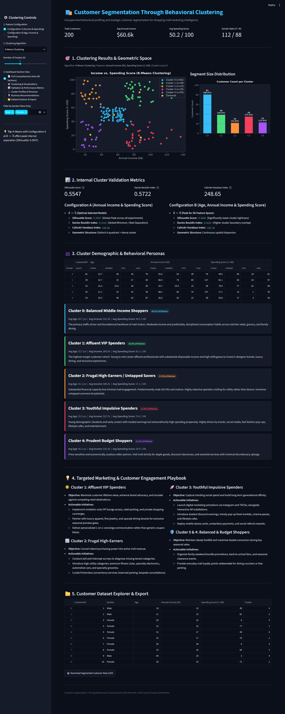

#### 2. Section 1 — Clustering Results & Geometric Space:
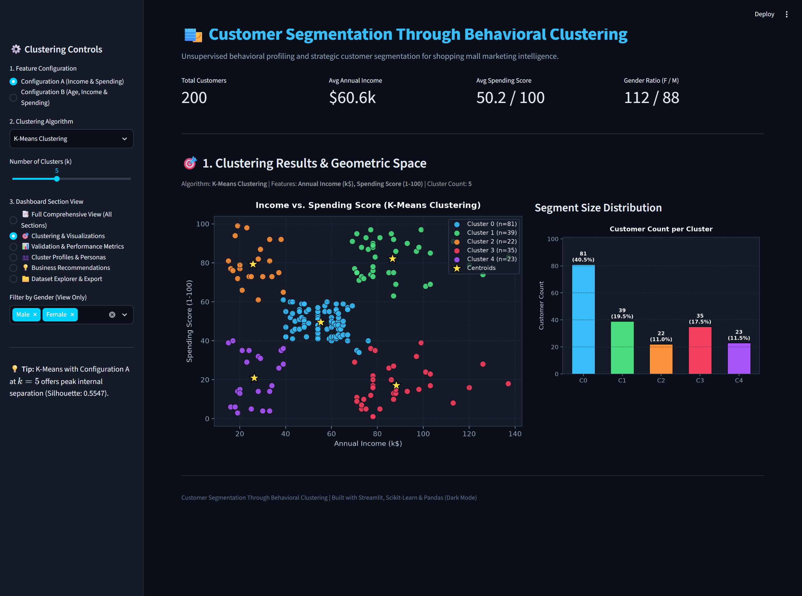

#### 3. Section 2 — Internal Cluster Validation Metrics:
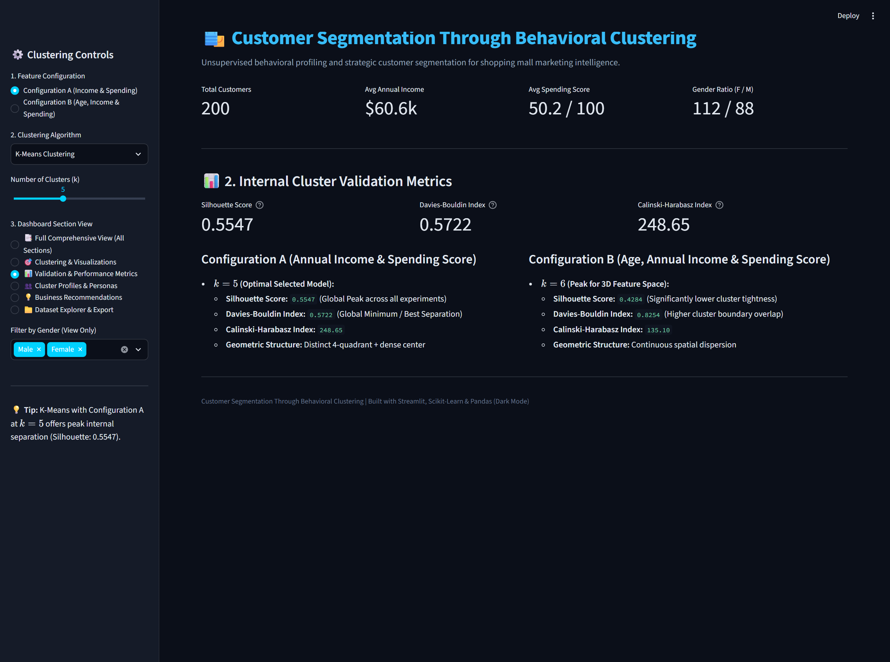

#### 4. Section 3 — Demographic & Behavioral Personas:
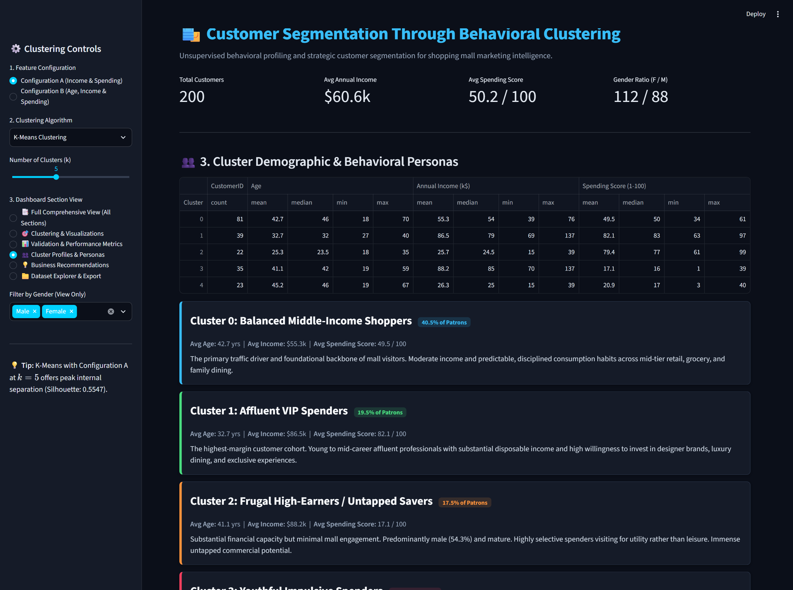

#### 5. Section 4 — Targeted Marketing Playbook:
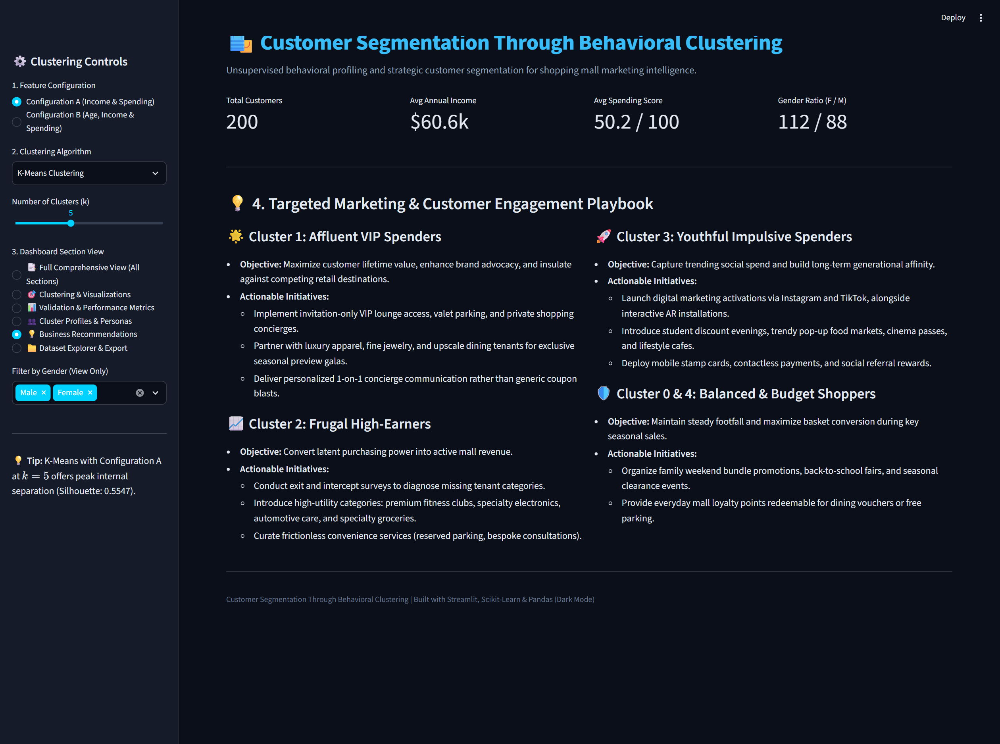

#### 6. Section 5 — Customer Dataset Explorer & Export:
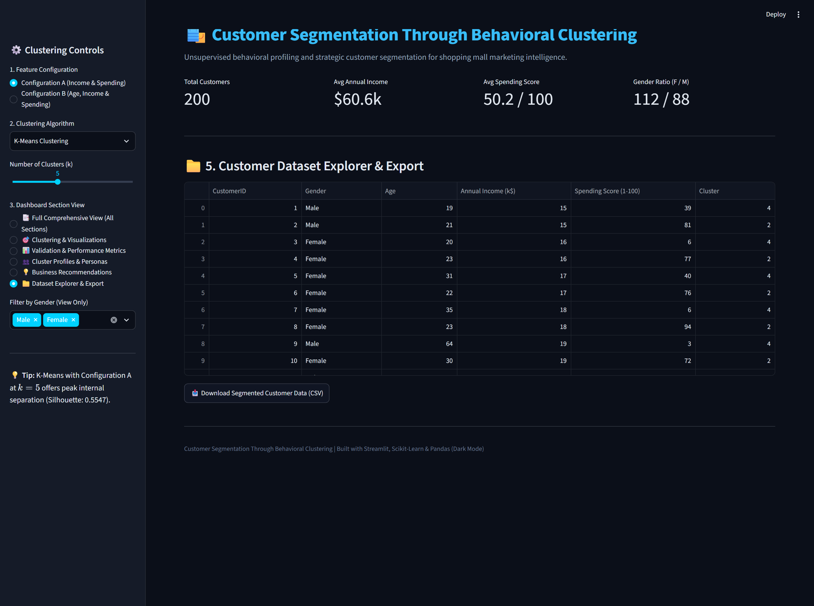

---

## 13. Technical Implementation and Reproducibility

### 13.1 Directory Organization
```text
Customer Segmentation Through Behavioral Clustering/
├── Mall_Customers.csv             # Input dataset (200 rows, 5 cols)
├── TASK.md                        # Project specification and requirements
├── final_report.md                # Primary comprehensive analytical report
├── requirements.txt               # Pinned reproducible dependencies
├── app.py                         # Interactive Streamlit web application
├── src/
│   └── customer_segmentation.py   # Executable data analysis and modeling script
├── scripts/
│   └── take_streamlit_screenshot.mjs # CDP screenshot automation script
└── outputs/
    ├── figures/                   # 14 high-resolution (300 DPI) analytical plots
    ├── tables/                    # CSV and Markdown tables for all experiments
    └── screenshots/               # Full-page application screenshots
```

### 13.2 Software Environment and Versions
- **Operating System:** Microsoft Windows 11
- **Python Version:** Python 3.15.1
- **Core Libraries:**
  - `pandas`: 3.1.1
  - `numpy`: 2.5.4
  - `scikit-learn`: 1.9.1
  - `scipy`: 1.18.1
  - `matplotlib`: 3.11.2
  - `seaborn`: 0.13.2
  - `streamlit`: 1.67.0
  - `tabulate`: 0.10.0
- **Random Seed:** Set globally to `42` (`np.random.seed(42)`, `random_state=42`) across all K-Means and PCA procedures to ensure 100% deterministic reproducibility.

### 13.3 Instructions to Reproduce
1. **Clone/Open Workspace:** Open the workspace directory in terminal.
2. **Install Dependencies:**
   ```bash
   pip install -r requirements.txt
   ```
3. **Run Analysis Pipeline:**
   ```bash
   python src/customer_segmentation.py
   ```
   *Generates all 14 figures in `figures/` and all 8 data tables in `outputs/tables/`.*
4. **Launch Interactive Application:**
   ```bash
   python -m streamlit run app.py
   ```
   *Access dashboard at `http://localhost:8501`.*

---

## 14. Conclusion

This project successfully establishes an unsupervised machine learning segmentation framework for mall customer intelligence. Through empirical evaluation of K-Means, Agglomerative Hierarchical, and DBSCAN algorithms across multiple feature spaces, the analysis demonstrates that **K-Means on Annual Income and Spending Score with $k=5$** offers the most statistically rigorous and commercially actionable customer segmentation.

The five discovered segments — **Balanced Middle-Income (40.5%)**, **Affluent VIP Spenders (19.5%)**, **Frugal High-Earners (17.5%)**, **Youthful Impulsive Spenders (11.0%)**, and **Prudent Budget Shoppers (11.5%)** — provide shopping mall executives with a clear strategic roadmap to transition from generic discounting to precision retail marketing.
